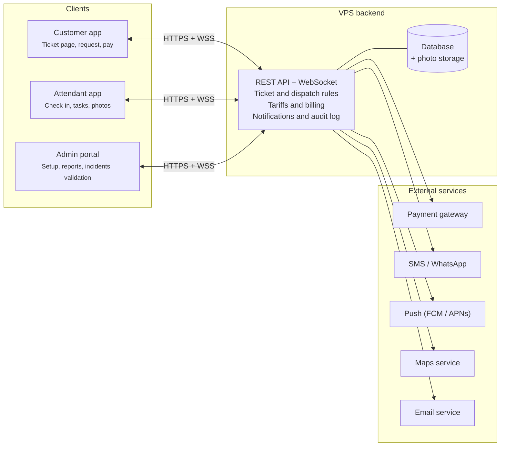
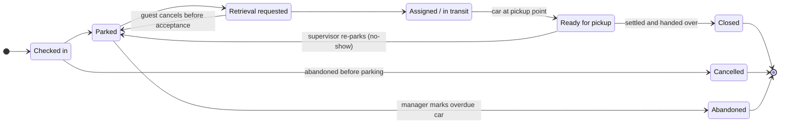

# Software Requirements Specification: Valet Parking System

Version 1.1 · Oct 17, 2026 · Manikanta

## Table of contents

1. [Introduction](#1-introduction)
2. [Overall description](#2-overall-description)
3. [Functional requirements](#3-functional-requirements)
4. [External interface requirements](#4-external-interface-requirements)
5. [Non-functional requirements](#5-non-functional-requirements)
6. [Data requirements](#6-data-requirements)
7. [Use cases](#7-use-cases)
8. [Open questions](#8-open-questions)

### Revision history

| Version | Date | Changes |
| --- | --- | --- |
| 1.0 | Oct 17, 2026 | Initial baseline |
| 1.1 | Oct 17, 2026 | Resolved review questions: handover PIN verification, printed ticket fallback made Must, optional guest mobile, offline ticket number blocks, no-show and abandoned vehicle handling, fee clock rules, zero-fee settlement, merchant accounts, tip allocation, ETA method, shifts, platform admin role, per-operator data isolation, anonymisation, supervisor override, 7-day guest link window, revised check-in time target. 11 new functional requirements (71 total). |

## 1. Introduction

The Valet Parking System (VPS) replaces paper valet tickets with a digital ticket that tracks every vehicle from drop-off to return, and lets guests request their car from their phone.

### 1.1 Purpose

This SRS defines the functional and non-functional requirements for VPS version 1.0. It is the agreed baseline for design, development, testing and acceptance, and follows the structure of IEEE 830 / ISO/IEC/IEEE 29148.

### 1.2 Scope

VPS consists of four components:

- **Customer web/mobile app** — receive a digital ticket, request the car, pay, rate the service.
- **Valet attendant app** — check vehicles in and out, record damage photos, park and retrieve.
- **Admin web portal** — manage operators, locations, staff, merchants, pricing, reports and incidents; merchant validation page.
- **Backend services** — API, database, notifications, payment integration.

In scope: hotels, restaurants, hospitals, malls and event venues running one or many valet locations. Out of scope for v1.0: automated (robotic) parking, licence-plate recognition cameras, self-park garage gate control, and billing operators for use of the platform.

### 1.3 Definitions and acronyms

| Term | Meaning |
| --- | --- |
| Valet ticket | Unique digital record (with QR code and short number) for one vehicle visit |
| Handover PIN | 4-digit code issued to the guest with the ticket, used to verify the guest at handover when the QR cannot be scanned; never shown to staff |
| Attendant | Staff member who parks and retrieves vehicles |
| Supervisor | Staff member who runs a shift at a location |
| Shift | Period between an attendant's clock-in and clock-out |
| Operator | A business (tenant) running valet service at one or more locations |
| Platform admin | Staff of the VPS provider who onboard and manage operators |
| Merchant | A business at a location (e.g. hotel front desk, restaurant) that validates guest tickets |
| Location | A site offering valet service, with one or more parking zones |
| Zone / Slot | An area and a numbered space within a location where cars are parked |
| Pickup point | A place at a location where cars are dropped off and handed back |
| Key tag | Physical tag or hook number where the vehicle key is stored |
| ETA | Estimated time for the car to reach the pickup point |
| OTP | One-time password sent by SMS |
| PCI DSS | Payment Card Industry Data Security Standard |

### 1.4 References

- IEEE Std 830-1998, Recommended Practice for Software Requirements Specifications
- ISO/IEC/IEEE 29148:2018, Requirements engineering
- PCI DSS v4.0
- WCAG 2.1, Web Content Accessibility Guidelines

### 1.5 Document overview

Section 2 describes the product context and users. Section 3 lists functional requirements by module. Sections 4 and 5 cover interfaces and quality attributes. Section 6 defines the data model and ticket lifecycle. Section 7 gives key use cases, and section 8 lists open questions.

## 2. Overall description

VPS is a new, cloud-hosted, multi-tenant product: one deployment serves many operators, each with many locations, and every client talks to a single backend API. Each operator's customer and vehicle data is kept separate from every other operator's.

### 2.1 Product perspective

The customer app, attendant app and admin portal are thin clients over a REST API. The backend owns all business rules and integrates with an SMS/WhatsApp gateway, a push-notification service, a payment gateway and a map service. The architecture diagram below shows the parts and what calls what.

The backend is the only component holding business rules and credentials for external services; clients never call those services directly.

### 2.2 Product functions (summary)

- Digital ticket issue at drop-off (QR code + SMS link, or printed ticket)
- Vehicle check-in with photos, damage notes, key tag and parking slot
- Car retrieval request by the guest, with live status and ETA
- Task queue and assignment for attendants
- Payment (prepaid at flat-tariff locations, pay-on-exit, validated/complimentary)
- Real-time occupancy dashboard per location
- Reports, audit trail and incident (damage) management

### 2.3 User classes

| User class | Main goals | Frequency | Technical skill |
| --- | --- | --- | --- |
| Customer (guest) | Get a ticket, request car, pay | 1–2 times per visit | Low; no app install required |
| Valet attendant | Check in, park, retrieve cars fast | Continuous during shift | Low–medium; uses phone with gloves, outdoors |
| Shift supervisor | Assign tasks, watch queue, handle issues, approve handover overrides | Continuous during shift | Medium |
| Location manager | Configure location, staff, pricing; view reports; handle overdue vehicles | Daily | Medium |
| Operator admin | Manage all of the operator's locations, merchants and settings | Weekly | High |
| Merchant / validator | Validate or comp a guest's ticket (e.g. hotel front desk) | Occasional | Low |
| Platform admin | Create, configure and suspend operators | Occasional | High |

### 2.4 Operating environment

- Customer app: responsive web (PWA) on current Chrome, Safari, Edge, Firefox; optional native Android 10+ / iOS 15+.
- Attendant app: Android 10+ and iOS 15+ phones; must work on rugged Android devices.
- Admin portal: desktop browsers at 1280×720 or larger.
- Backend: cloud hosting (e.g. AWS, Azure or GCP), containerised, relational database.

### 2.5 Design and implementation constraints

- Card data must never be stored by VPS; payments go through a PCI DSS compliant gateway (tokenised).
- Personal data handling must comply with applicable privacy law (e.g. India DPDP Act 2023, GDPR where guests are in the EU).
- Customer and vehicle data must be isolated per operator and never shared across operators.
- The attendant app must keep working through short network loss (offline queue, sync on reconnect).
- All timestamps stored in UTC and shown in the location's time zone.

### 2.6 Assumptions and dependencies

- Each location has mobile data or Wi-Fi coverage at the drop-off and pickup points.
- Most guests provide a mobile number to receive the ticket link; guests who do not receive a printed ticket.
- Each location has at least one working Bluetooth ticket printer.
- Third-party SMS, payment and push services are available at 99.9% or better.
- Physical key storage (key box/hooks) exists and is numbered.

## 3. Functional requirements

VPS has 71 functional requirements across nine modules; priorities use MoSCoW (Must, Should, Could), and every Must item is required for v1.0 acceptance.

### 3.1 Authentication and user management

| ID | Requirement | Priority |
| --- | --- | --- |
| FR-AUTH-01 | Staff and merchant validators shall log in with mobile number/email and password; customers shall access tickets via OTP or a signed ticket link without creating an account. | Must |
| FR-AUTH-02 | The system shall enforce role-based access control for the roles in section 2.3. | Must |
| FR-AUTH-03 | Admins shall create, edit, deactivate staff and assign them to one or more locations. | Must |
| FR-AUTH-04 | Staff sessions on the attendant app shall expire at clock-out or 12 hours after clock-in, whichever comes first. | Should |
| FR-AUTH-05 | Admin users shall be able to enable two-factor authentication. | Should |
| FR-AUTH-06 | Attendants shall clock in and clock out of a shift from the app; a shift runs from clock-in to clock-out. | Should |
| FR-AUTH-07 | Platform admins shall create, configure and suspend operators and create each operator's first admin account. | Must |

### 3.2 Vehicle check-in (drop-off)

| ID | Requirement | Priority |
| --- | --- | --- |
| FR-IN-01 | The attendant shall create a ticket by entering the plate number; guest mobile number, vehicle make, model and colour shall be optional, with quick-pick lists for make and colour. | Must |
| FR-IN-02 | The system shall generate a unique ticket number, QR code and 4-digit handover PIN and, when a mobile number is given, send the guest a ticket link and PIN by SMS/WhatsApp within 10 seconds (or on sync if issued offline). | Must |
| FR-IN-03 | The attendant shall capture at least 4 vehicle photos (front, rear, left, right) with timestamp before parking. | Must |
| FR-IN-04 | The attendant shall mark existing damage on a vehicle diagram with notes. | Should |
| FR-IN-05 | The attendant shall record the key tag number. | Must |
| FR-IN-06 | The system shall print a ticket (ticket number, QR code, handover PIN) via Bluetooth printer when the guest gives no mobile number, the device is offline, or the guest asks for one. | Must |
| FR-IN-07 | The system shall recognise returning vehicles by plate number within the same operator and pre-fill details. | Could |
| FR-IN-08 | The guest shall see and accept the terms and the recorded condition photos in the ticket page. | Should |
| FR-IN-09 | The attendant shall be able to record fuel level and odometer reading (optional fields). | Could |
| FR-IN-10 | While online, each attendant device shall reserve a block of ticket numbers and signed QR tokens so it can issue tickets offline; offline tickets shall sync automatically on reconnect. | Must |

### 3.3 Parking and slot management

| ID | Requirement | Priority |
| --- | --- | --- |
| FR-PARK-01 | Admins shall define zones and numbered slots per location, with capacity. | Must |
| FR-PARK-02 | The attendant shall record the zone and slot where the vehicle is parked. | Must |
| FR-PARK-03 | The system shall suggest the nearest free slot based on current occupancy. | Should |
| FR-PARK-04 | The system shall prevent assigning a slot that is already occupied; conflicts from slots assigned offline shall be detected on sync and flagged to the supervisor. | Must |
| FR-PARK-05 | Attendants shall move a vehicle to a new slot and the move shall be logged. | Must |
| FR-PARK-06 | The system shall alert the supervisor when a location reaches 90% occupancy. | Should |
| FR-PARK-07 | At check-in the system shall create a park task assigned to the checking-in attendant and close it when the slot is recorded. | Must |

### 3.4 Vehicle retrieval (pickup request)

| ID | Requirement | Priority |
| --- | --- | --- |
| FR-OUT-01 | The guest shall request the car from the ticket page with one tap, choosing a pickup point (default: the drop-off point). | Must |
| FR-OUT-02 | The guest shall be able to schedule a pickup for a future time (up to 24 hours ahead). | Should |
| FR-OUT-03 | Staff shall create a retrieval request on behalf of a guest by ticket number, plate or QR scan (e.g. guests with a printed ticket). | Must |
| FR-OUT-04 | The system shall show the guest live status (Requested, Assigned, On the way, Ready) and an ETA calculated as the estimated queue wait plus the configured average retrieval time from the vehicle's zone to the chosen pickup point. | Must |
| FR-OUT-05 | The guest shall receive a notification when the car is ready at the pickup point. | Must |
| FR-OUT-06 | Before handover, the attendant shall verify the guest by scanning the ticket QR or, if the QR is unavailable, entering the guest's 4-digit handover PIN. | Must |
| FR-OUT-07 | The attendant shall capture return photos and close the ticket on handover. | Should |
| FR-OUT-08 | The guest shall be able to cancel a retrieval request until an attendant accepts it. | Should |
| FR-OUT-09 | A supervisor shall be able to send a car waiting at the pickup point back to a slot (guest no-show); the guest is notified and must request the car again. | Should |
| FR-OUT-10 | When verification fails, a supervisor shall approve the handover by recording the ID document type and its last 4 characters and taking a photo of the ID or the guest with the car; overrides shall be logged and shown in reports. | Must |
| FR-OUT-11 | The system shall refine each zone's average retrieval time from actual retrieval history. | Could |

### 3.5 Task dispatch and attendant workflow

| ID | Requirement | Priority |
| --- | --- | --- |
| FR-TASK-01 | The system shall place every retrieval request in a location queue ordered by request time (scheduled requests at their due time). | Must |
| FR-TASK-02 | Attendants shall accept a task from the queue; one task shall be held by only one attendant. | Must |
| FR-TASK-03 | Supervisors shall assign, re-assign and re-prioritise tasks (e.g. VIP). | Must |
| FR-TASK-04 | The system shall auto-assign tasks to the available attendant with the fewest active tasks when auto-dispatch is on. | Could |
| FR-TASK-05 | The system shall alert the supervisor when a task is not accepted within a configurable time (default 2 minutes). | Should |
| FR-TASK-06 | The attendant app shall show the slot, key tag, vehicle details and photos for each task. | Must |

### 3.6 Payment and billing

| ID | Requirement | Priority |
| --- | --- | --- |
| FR-PAY-01 | Admins shall configure tariffs per location: flat fee, hourly, daily cap, overnight, and free minutes. | Must |
| FR-PAY-02 | The system shall calculate the fee from check-in to the time of the latest non-cancelled retrieval request (for a scheduled pickup, the scheduled time) using the location tariff; a cancelled request does not stop the fee clock. | Must |
| FR-PAY-03 | The guest shall pay online by card, UPI or wallet via the payment gateway before or at pickup. | Must |
| FR-PAY-04 | The attendant shall record cash or card-terminal payment at handover. | Must |
| FR-PAY-05 | Merchant validators shall validate a ticket for free or discounted parking within their merchant's allowed discounts and monthly cap. | Should |
| FR-PAY-06 | The guest shall be able to add a tip; each location shall configure whether tips go to the retrieving attendant or to a shift pool. | Could |
| FR-PAY-07 | The system shall issue a digital receipt with tax breakdown by SMS/email. | Must |
| FR-PAY-08 | Managers shall issue full or partial refunds, with a reason, logged in the audit trail. | Should |
| FR-PAY-09 | The system shall support monthly pass holders who are not charged per visit. | Could |
| FR-PAY-10 | At locations with a flat tariff, the guest shall be able to prepay at check-in. | Should |
| FR-PAY-11 | Admins shall create merchants (name, locations, allowed discount types and values, monthly cap) and their validator accounts. | Should |
| FR-PAY-12 | A ticket with nothing due (complimentary, full validation or monthly pass) shall be settled with a payment record of amount 0 stating the reason. | Must |

### 3.7 Notifications

| ID | Requirement | Priority |
| --- | --- | --- |
| FR-NOT-01 | The system shall send the guest SMS/WhatsApp messages on ticket issue, car ready, car returned to slot, overdue reminder and payment receipt. | Must |
| FR-NOT-02 | The attendant app shall receive push notifications for new and assigned tasks. | Must |
| FR-NOT-03 | Admins shall edit message templates per location and language. | Should |
| FR-NOT-04 | The system shall retry failed messages up to 3 times and log the delivery status. | Should |

### 3.8 Incident and damage management

| ID | Requirement | Priority |
| --- | --- | --- |
| FR-INC-01 | Staff and guests shall report an incident (damage, lost item, delay) linked to a ticket, with photos; guests can report through the ticket link until it expires (NFR-SEC-02). | Must |
| FR-INC-02 | Each incident shall have a status (Open, Under review, Resolved, Rejected) and an owner. | Must |
| FR-INC-03 | The incident view shall show check-in and return photos side by side for comparison. | Should |
| FR-INC-04 | Managers shall export an incident report as PDF for insurance claims. | Should |

### 3.9 Admin, dashboard and reporting

| ID | Requirement | Priority |
| --- | --- | --- |
| FR-ADM-01 | Admins shall create and configure locations: address, operating hours, zones, tariffs, pickup points, and average retrieval time from each zone to each pickup point. | Must |
| FR-ADM-02 | The dashboard shall show live per-location counts: cars parked, free slots, open requests, average wait time. | Must |
| FR-ADM-03 | The system shall provide daily, weekly and monthly reports: tickets, revenue, payment mix, tips, average retrieval time, attendant performance, handover overrides. | Must |
| FR-ADM-04 | Reports shall be exportable to CSV and PDF. | Must |
| FR-ADM-05 | The system shall keep an audit log of all create, update, delete and payment actions with user and timestamp. | Must |
| FR-ADM-06 | Supervisors shall search tickets by number, plate, mobile number or date range. | Must |
| FR-ADM-07 | The system shall collect a 1–5 star rating and comment from the guest after handover, while the ticket link is valid. | Should |
| FR-ADM-08 | Tickets older than a configurable limit (default 24 hours) shall be listed as overdue; the system shall alert the location manager and send the guest a reminder. | Should |
| FR-ADM-09 | The system shall support multiple languages for the customer app (English plus at least one regional language). | Should |
| FR-ADM-10 | Managers shall mark an overdue vehicle as Abandoned with a reason; this ends the ticket, frees the slot and is logged in the audit trail. | Should |

## 4. External interface requirements

All clients use one versioned HTTPS REST API (JSON), plus a WebSocket channel for live status; external services are reached only from the backend.

### 4.1 User interfaces

- **Customer ticket page:** opens from the SMS link without login; shows ticket number, QR code, handover PIN, vehicle photo, status, ETA, fee, pickup point choice and a large "Request my car" button.
- **Attendant app:** large touch targets (at least 48×48 dp), high-contrast theme for outdoor use, QR scanner, camera capture, ticket printing, task list with one-tap accept. Handover PINs are never displayed.
- **Admin portal:** dashboard, operator setup (platform admins), location setup, staff, merchants, tariffs, tickets, incidents, reports; tables with search, filter and export.
- **Merchant validation page:** scan or enter a ticket number and apply an allowed discount.
- All interfaces shall meet WCAG 2.1 level AA.

### 4.2 Hardware interfaces

| Device | Use | Requirement |
| --- | --- | --- |
| Smartphone camera | Vehicle photos, ID photos, QR scan | Min. 8 MP, autofocus |
| Bluetooth thermal printer | Printed tickets (no mobile number, offline, on request) | At least one per location; ESC/POS compatible, 58 or 80 mm |
| Card payment terminal | Card payment at handover | Standalone; amount entered manually in v1.0 |
| Display screen at pickup | Queue / "car ready" board | Any browser-capable screen (optional) |

### 4.3 Software interfaces

| System | Purpose | Interface |
| --- | --- | --- |
| Payment gateway (e.g. Razorpay, Stripe) | Online payments, refunds | REST API + webhooks, tokenised cards |
| SMS / WhatsApp gateway (e.g. Twilio, MSG91) | Ticket links, PINs, OTP, alerts | REST API, delivery-status callbacks |
| Push service (FCM / APNs) | Attendant task alerts | Provider SDK |
| Maps service (e.g. Google Maps) | Location address, directions to pickup point | JavaScript / REST API |
| Email service (e.g. SES, SendGrid) | Receipts, reports | SMTP / REST API |
| Object storage (e.g. S3) | Vehicle, incident and override photos | Signed URLs |

### 4.4 Communication interfaces

- All traffic shall use TLS 1.2 or higher.
- The API shall use JSON over HTTPS, versioned in the path (e.g. /api/v1).
- Live status updates shall use WebSocket, with fallback to polling every 10 seconds.
- Webhooks from external services shall be verified by signature.

## 5. Non-functional requirements

The targets below are measurable acceptance criteria; the headline ones are 99.9% monthly uptime, API responses under 500 ms at the 95th percentile, and zero stored card data.

| ID | Category | Requirement |
| --- | --- | --- |
| NFR-PERF-01 | Performance | 95% of API requests shall complete in under 500 ms; 99% under 2 s. |
| NFR-PERF-02 | Performance | A retrieval request shall appear in the attendant queue within 3 s of the guest tapping "Request". |
| NFR-PERF-03 | Performance | The customer ticket page shall load in under 3 s on a 4G connection. |
| NFR-SCAL-01 | Scalability | The system shall support 500 locations, 5,000 concurrent staff users and 50,000 tickets per day without redesign. |
| NFR-SCAL-02 | Scalability | A single location shall handle peaks of 300 check-ins per hour. |
| NFR-AVL-01 | Availability | Monthly uptime shall be at least 99.9%, excluding announced maintenance (max 4 hours/month, off-peak). |
| NFR-AVL-02 | Availability | The attendant app shall issue tickets from its reserved number block and queue check-ins and status changes offline for up to 30 minutes, then sync automatically (FR-IN-10). |
| NFR-REC-01 | Recoverability | Database backups every 24 hours plus point-in-time recovery; RPO 15 minutes, RTO 4 hours. |
| NFR-SEC-01 | Security | Passwords and handover PINs shall be hashed (bcrypt or Argon2); data encrypted in transit (TLS 1.2+) and at rest (AES-256). |
| NFR-SEC-02 | Security | Ticket links shall use unguessable signed tokens. After ticket closure a link shall allow only viewing the receipt, rating and reporting an incident, and shall expire after a configurable period per location (default 7 days). |
| NFR-SEC-03 | Security | Accounts shall lock for 15 minutes after 5 failed logins. |
| NFR-SEC-04 | Security | The system shall be tested against the OWASP Top 10 before each major release. |
| NFR-PRIV-01 | Privacy | Guest mobile numbers shall be masked to staff (last 4 digits) except supervisors and above. Handover PINs shall never be shown to any staff role. |
| NFR-PRIV-02 | Privacy | After a configurable retention period (default 90 days), vehicle and ID photos shall be deleted and the guest's name, mobile number and plate number shall be anonymised on tickets, while financial and audit fields are kept per section 6.3; records linked to an open incident are exempt until it closes. |
| NFR-PRIV-03 | Privacy | Customer and vehicle records shall belong to a single operator and shall never be visible to or matched across other operators. |
| NFR-USE-01 | Usability | An attendant shall complete a check-in with the required fields (plate number, key tag, 4 photos) in under 60 seconds; optional fields and the damage diagram are excluded from this target. |
| NFR-USE-02 | Usability | A new attendant shall be productive after 30 minutes of training. |
| NFR-MNT-01 | Maintainability | Backend code shall have at least 70% automated test coverage; deployments via CI/CD with rollback. |
| NFR-MNT-02 | Maintainability | The system shall provide centralised logs, metrics and alerting for errors and latency. |
| NFR-PORT-01 | Portability | Services shall run in containers and avoid lock-in to one cloud provider's proprietary services where practical. |
| NFR-LEG-01 | Compliance | Payment flows shall comply with PCI DSS (SAQ A scope); invoices shall meet local tax (e.g. GST) rules. |

## 6. Data requirements

The Ticket is the central record: every vehicle, photo, task, payment and incident hangs off one ticket, and its status moves through a fixed lifecycle.

### 6.1 Core entities

| Entity | Key attributes | Relationships |
| --- | --- | --- |
| Operator (tenant) | id, name, tax id, status (active/suspended), settings | has many Locations, Users, Merchants, Customers, Vehicles |
| Location | id, name, address, time zone, hours, capacity, tip policy (attendant/pool), link expiry days | has many Zones, Tariffs, Pickup points, Tickets |
| Zone / Slot | id, code, slot number, status (free/occupied/blocked) | belongs to Location; holds 0–1 Vehicle |
| Pickup point | id, name, average retrieval time per zone | belongs to Location |
| User | id, name, mobile, email, role, status | assigned to Locations; performs Tasks; works Shifts |
| Shift | id, user, location, clock-in time, clock-out time | belongs to User |
| Customer | id, mobile (optional), name (optional), language | belongs to Operator; has many Tickets, Vehicles |
| Vehicle | id, plate number, make, model, colour | belongs to Operator; has many Tickets |
| Ticket | id, ticket number, QR token, handover PIN (hashed), status, check-in time, request time, scheduled time, close time, key tag, slot, pickup point, abandoned reason | links Customer, Vehicle, Location; has Photos, Tasks, Payments, Incidents, Overrides |
| Photo | id, type (check-in/return/incident/override), URL, timestamp, taken by | belongs to Ticket, Incident or Override |
| Task | id, type (park/retrieve/move), status, assigned to, timestamps | belongs to Ticket |
| Tariff | id, type, rates, free minutes, daily cap, valid from/to | belongs to Location |
| Payment | id, amount (may be 0), zero-fee reason, tax, tip, tip recipient (attendant or pool), method, gateway ref, status | belongs to Ticket |
| Merchant | id, name, locations, allowed discount types and values, monthly cap | belongs to Operator; has validator Users and Validations |
| Validation | id, merchant, validated by, discount type/value | applied to Ticket |
| Handover override | id, supervisor, ID document type, ID last 4 characters, timestamp | belongs to Ticket; has Photo |
| Incident | id, type, description, status, owner | belongs to Ticket |
| Audit log | id, user, action, entity, before/after, timestamp | references any entity |

### 6.2 Ticket lifecycle

A ticket normally moves through the states below in order. Cancelled is reachable only before Parked, and Abandoned only from Parked.

1. **Checked in** — ticket created at drop-off; photos and details captured.
2. **Parked** — vehicle placed in a slot; slot marked occupied; park task closed.
3. **Retrieval requested** — guest or staff requests the car (or a scheduled time arrives).
4. **Assigned / In transit** — an attendant accepted the task and is bringing the car.
5. **Ready for pickup** — car at the pickup point; guest notified.
6. **Closed** — balance settled (paid, or nothing due per FR-PAY-12) and car handed over; slot freed.

Other transitions:

- A retrieval request cancelled by the guest before an attendant accepts it returns the ticket to Parked (FR-OUT-08).
- A car not collected at the pickup point can be returned to a slot by a supervisor (FR-OUT-09); the ticket returns to Parked.
- An overdue vehicle can be marked **Abandoned** by a manager (FR-ADM-10); the ticket ends and the slot is freed.

### 6.3 Data retention

- Tickets, payments and audit logs: retained 8 years for tax/accounting (configurable per jurisdiction), with guest personal data anonymised per NFR-PRIV-02.
- Photos and guest contact data: per NFR-PRIV-02.

## 7. Use cases

Four use cases cover the core guest journey; each lists actor, preconditions, main flow and the main exceptions.

### UC-01 Drop off vehicle

- **Actor:** Valet attendant (primary), Customer
- **Precondition:** Attendant logged in and clocked in at the location.
- **Main flow:**
  1. Guest arrives at the drop-off point and hands over the key.
  2. Attendant enters the plate number and, if given, the guest mobile number and vehicle details (FR-IN-01).
  3. Attendant captures 4 photos and notes damage (FR-IN-03, FR-IN-04).
  4. Attendant records key tag; system issues ticket and sends the link and handover PIN (FR-IN-05, FR-IN-02).
  5. Attendant parks the car and records zone and slot; the park task closes (FR-PARK-02, FR-PARK-07).
- **Exceptions:** No network → ticket issued from the device's reserved number block, printed, and synced on reconnect; the SMS is sent after sync (FR-IN-10, FR-IN-06, NFR-AVL-02). Guest declines to give a number → printed ticket only; the guest later requests the car at the valet desk (FR-OUT-03). Slot conflict found on sync → supervisor alerted (FR-PARK-04).
- **Postcondition:** Ticket in state Parked; slot occupied.

### UC-02 Request vehicle

- **Actor:** Customer
- **Precondition:** Ticket in state Parked.
- **Main flow:**
  1. Guest opens the ticket link, chooses a pickup point and taps "Request my car" (FR-OUT-01).
  2. System shows the fee and offers online payment (FR-PAY-02, FR-PAY-03).
  3. System adds the task to the queue and notifies attendants (FR-TASK-01, FR-NOT-02).
  4. Guest sees live status and ETA (FR-OUT-04).
- **Exceptions:** Payment fails → guest can pay at handover. Guest cancels before an attendant accepts → ticket returns to Parked and the fee clock keeps running (FR-OUT-08, FR-PAY-02). Guest has a printed ticket → staff create the request (FR-OUT-03).

### UC-03 Retrieve and hand over vehicle

- **Actor:** Valet attendant
- **Precondition:** Retrieval task in queue.
- **Main flow:**
  1. Attendant accepts the task and sees slot, key tag and photos (FR-TASK-02, FR-TASK-06).
  2. Attendant drives the car to the pickup point and marks it Ready; guest notified (FR-OUT-05).
  3. Attendant verifies the guest by QR scan or handover PIN (FR-OUT-06).
  4. Attendant collects payment if a balance is due, captures return photos and closes the ticket (FR-PAY-04, FR-PAY-12, FR-OUT-07).
- **Exceptions:** Task not accepted in 2 minutes → supervisor alerted (FR-TASK-05). Verification fails → supervisor override with ID record and photo (FR-OUT-10). Guest does not arrive → supervisor may return the car to a slot (FR-OUT-09).
- **Postcondition:** Ticket Closed; slot free; receipt sent (FR-PAY-07).

### UC-04 Report damage

- **Actor:** Customer or staff; Location manager
- **Main flow:**
  1. Reporter opens the ticket and submits an incident with photos; a guest can do this until the ticket link expires, by default 7 days after closure (FR-INC-01, NFR-SEC-02).
  2. Manager compares check-in and return photos (FR-INC-03).
  3. Manager sets the outcome and exports the report if needed (FR-INC-02, FR-INC-04).

## 8. Open questions

- [ ] Which payment gateway and SMS provider will be used in the first market?
- [ ] Is a native app required for customers in v1.0, or is the web ticket page enough?
- [ ] Should licence-plate recognition be planned for v2.0?
- [ ] What is the legally required retention period for vehicle photos in the target jurisdictions?
- [ ] Is integration with hotel property-management systems (room charge) required?
- [ ] What legal process (notice period, towing, release to owner) applies to abandoned vehicles in the target jurisdictions?
