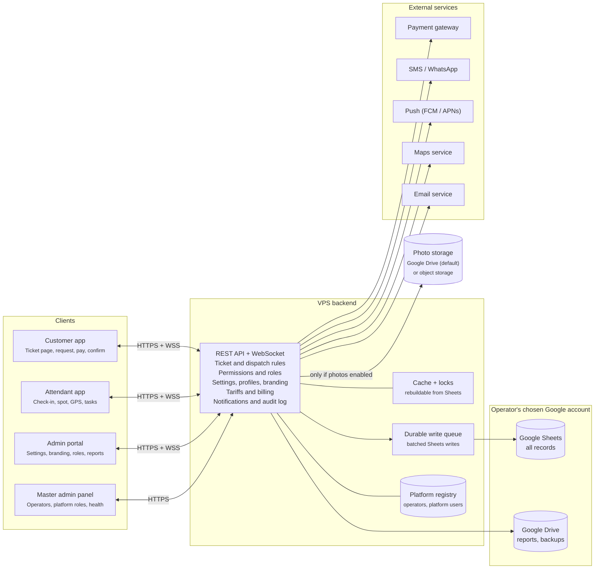
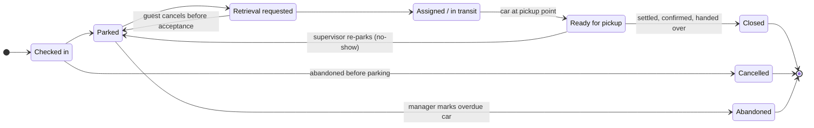

# Software Requirements Specification: Valet Parking System

Version 1.5 · Oct 17, 2026 · Manikanta

## Table of contents

1. [Introduction](#1-introduction)
2. [Overall description](#2-overall-description)
3. [Functional requirements](#3-functional-requirements)
4. [External interface requirements](#4-external-interface-requirements)
5. [Non-functional requirements](#5-non-functional-requirements)
6. [Data requirements](#6-data-requirements)
7. [Use cases](#7-use-cases)
8. [Open questions](#8-open-questions)

### Revision history

| Version | Date | Changes |
| --- | --- | --- |
| 1.0 | Oct 17, 2026 | Initial baseline |
| 1.1 | Oct 17, 2026 | Resolved review questions: handover PIN verification, printed ticket fallback made Must, optional guest mobile, offline ticket number blocks, no-show and abandoned vehicle handling, fee clock rules, zero-fee settlement, merchant accounts, tip allocation, ETA method, shifts, platform admin role, per-operator data isolation, anonymisation, supervisor override, 7-day guest link window, revised check-in time target. 11 new functional requirements (71 total). |
| 1.2 | Oct 17, 2026 | Configurable service profiles (paid parking, restaurant, hotel, event venue, custom) with a settings catalogue managed from the admin panel. Data stored in each operator's own Google Drive and Google Sheets instead of a separate database; scale, performance, availability and recovery targets revised to fit. 18 new functional requirements (89 total). |
| 1.3 | Oct 17, 2026 | Vehicle photos made optional and configurable per vendor. Parking spot entered as free text by default, with zone/slot list as an option. Photo storage made a separate, selectable integration (Google Drive by default); records stay in Google Sheets. Photos deleted automatically when the guest link expires after handover. Guest no-damage confirmation required at handover. 4 new functional requirements (93 total). |
| 1.4 | Oct 17, 2026 | Parking spot capture configurable per client: text, landmark text with GPS location, photo with text, or zone/slot list. White-label branding with a custom app name per client. Settings levels (platform, operator, location). Google Drive integration configurable per client. Master admin panel and permission-based roles, including custom roles assigned per location. 18 new functional requirements (111 total). |
| 1.5 | Oct 17, 2026 | Parking spot text field, GPS location and spot photo each switchable to off, optional or required per location, independently of each other, with the zone/slot list as a separate switch; rules so a spot is never saved empty. 1 new functional requirement (112 total). |

## 1. Introduction

The Valet Parking System (VPS) replaces paper valet tickets with a digital ticket that tracks every vehicle from drop-off to return, and lets guests request their car from their phone. The same product serves paid parking operators, restaurants, hotels and event venues: each client runs it under their own app name and branding, picks a service profile for each location, and adjusts its rules, roles and Google Drive integration from the admin panel.

### 1.1 Purpose

This SRS defines the functional and non-functional requirements for VPS version 1.0. It is the agreed baseline for design, development, testing and acceptance, and follows the structure of IEEE 830 / ISO/IEC/IEEE 29148.

### 1.2 Scope

VPS consists of five components:

- **Customer web/mobile app** — receive a digital ticket, request the car, pay, confirm handover, rate the service; shown under the client's app name.
- **Valet attendant app** — check vehicles in and out, record the parking spot (text, GPS, photo or slot), park and retrieve.
- **Admin web portal** — for each operator: locations, service profiles and settings, branding, roles and users, merchants, pricing, Google Drive integration, reports and incidents; merchant validation page.
- **Master admin panel** — for the VPS platform team: operators, platform roles and users, platform default settings and profiles, and integration health of every operator.
- **Backend services** — API, business rules, permission checks, notifications, payment integration, the data layer that stores all records in the operator's Google Sheets, and the photo storage integration.

In scope: paid parking operators, restaurants, hotels, hospitals, malls and event venues running one or many valet locations, each configured through service profiles (section 2.7). Out of scope for v1.0: automated (robotic) parking, licence-plate recognition cameras, self-park garage gate control, billing operators for use of the platform, a separate database server, and separate app-store builds of the native apps for each client.

### 1.3 Definitions and acronyms

| Term | Meaning |
| --- | --- |
| Valet ticket | Unique digital record (with QR code and short number) for one vehicle visit |
| Handover PIN | 4-digit code issued to the guest with the ticket, used to verify the guest at handover when the QR cannot be scanned; never shown to staff |
| Handover confirmation | The guest's confirmation, at handover, that the car was received with no new damage, or their report that it was not |
| Attendant | Staff member who parks and retrieves vehicles |
| Supervisor | Staff member who runs a shift at a location |
| Shift | Period between an attendant's clock-in and clock-out |
| Operator / client / vendor | A business (tenant) running valet service at one or more locations |
| Platform admin | Staff of the VPS provider who onboard and manage operators through the master admin panel |
| Master admin panel | The platform-level admin panel used by the VPS provider's own staff |
| Merchant | A business at a location (e.g. hotel front desk, restaurant) that validates guest tickets |
| Location | A site offering valet service |
| Service profile | A named preset of location settings for a type of business (e.g. Paid parking, Restaurant) |
| Setting | A configurable business rule, listed in the settings catalogue (section 2.7) |
| Settings level | Where a setting value is set: platform default, operator default or location |
| Custom field | An extra check-in field defined by an admin (e.g. room number, reservation name) |
| Parking spot | Where the car is parked, captured in the way the client chooses: text, landmark text with GPS location, photo with text, or a zone and slot from a list |
| Landmark | A short text description of a nearby reference point (e.g. "opposite Gate 3, second row") |
| GPS location | Latitude, longitude and accuracy captured from the attendant's phone when the parking spot is saved |
| Zone / Slot | An area and a numbered space within a location, used when the location uses zone/slot mode |
| Pickup point | A place at a location where cars are dropped off and handed back |
| Photo storage | The integration that holds photos (Google Drive by default); separate from the Google Sheets records |
| App name | The client's own name for the product, shown to guests and staff instead of "VPS" |
| Permission | A single action a user may perform (e.g. approve handover override) |
| Role | A named set of permissions; built-in or custom |
| Role assignment | A role given to a user for selected locations or for all of the operator's locations |
| Key tag | Physical tag or hook number where the vehicle key is stored |
| ETA | Estimated time for the car to reach the pickup point |
| OTP | One-time password sent by SMS |
| OAuth | Open standard used to let VPS access a Google account with its owner's consent |
| PCI DSS | Payment Card Industry Data Security Standard |

### 1.4 References

- IEEE Std 830-1998, Recommended Practice for Software Requirements Specifications
- ISO/IEC/IEEE 29148:2018, Requirements engineering
- PCI DSS v4.0
- WCAG 2.1, Web Content Accessibility Guidelines
- Google Sheets API and Google Drive API documentation, including usage limits

### 1.5 Document overview

Section 2 describes the product context, users, configurability, branding and roles. Section 3 lists functional requirements by module. Sections 4 and 5 cover interfaces and quality attributes. Section 6 defines the data model, ticket lifecycle and Google Drive storage layout. Section 7 gives key use cases, and section 8 lists open questions.

## 2. Overall description

VPS is a new, cloud-hosted, multi-tenant product: one deployment serves many operators, each with many locations, and every client talks to a single backend API. There is no separate database server: each operator's records live in Google Sheets in the Google account the operator chooses. Photos, where a client enables them, go to a separate photo storage integration.

### 2.1 Product perspective

The customer app, attendant app, admin portal and master admin panel are thin clients over a REST API. The backend owns all business rules and permission checks, and integrates with an SMS/WhatsApp gateway, a push-notification service, a payment gateway, a map service, the operator's Google Sheets and Drive, and the operator's chosen photo storage. Because Google Sheets has no transactions or row locks and limits API calls per minute, the backend keeps a rebuildable in-memory cache with locks for live operations, and a durable write queue that batches writes to Sheets. The architecture diagram below shows the parts and what calls what.



The backend is the only component holding business rules and credentials for external services; clients never call those services, the operator's Google account or the photo storage directly.

### 2.2 Product functions (summary)

- Digital ticket issue at drop-off (QR code + SMS link, or printed ticket)
- Vehicle check-in with key tag, custom fields and optional vehicle photos
- Parking spot capture chosen per client: text, landmark + GPS location, photo + text, or zone/slot
- Car retrieval request by the guest, merchant or staff, with live status and ETA
- Task queue and assignment for attendants, with the parked car shown on a map where GPS is used
- Guest no-damage confirmation at handover
- Payment (prepaid at flat-tariff locations, pay-on-exit, validated/complimentary)
- White-label branding with the client's own app name
- Service profiles and settings at platform, operator and location level
- Master admin panel and permission-based roles, including custom roles
- Live dashboard per location
- Reports, audit trail and incident (damage) management
- All records kept in Google Sheets in the client's chosen Google account, with a configurable Drive integration

### 2.3 User classes

The table lists the built-in roles. Operators can also create custom roles (section 2.9).

| User class | Main goals | Frequency | Technical skill |
| --- | --- | --- | --- |
| Customer (guest) | Get a ticket, request car, pay, confirm handover | 1–2 times per visit | Low; no app install required |
| Valet attendant | Check in, park, record spot, retrieve cars fast | Continuous during shift | Low–medium; uses phone with gloves, outdoors |
| Shift supervisor | Assign tasks, watch queue, handle issues, approve handover overrides | Continuous during shift | Medium |
| Location manager | Configure location, staff, pricing; view reports; handle overdue vehicles | Daily | Medium |
| Operator admin | Set branding, app name, Google Drive integration, roles and users; manage locations, settings, merchants | Weekly | High |
| Merchant / validator | Validate or comp a guest's ticket; request a guest's car (e.g. restaurant host) | Occasional | Low |
| Platform admin | Create, configure and suspend operators; manage platform roles, defaults and profiles | Occasional | High |
| Platform support | Check operators' setup and integration health; help with configuration | Occasional | High |

### 2.4 Operating environment

- Customer app: responsive web (PWA) on current Chrome, Safari, Edge, Firefox; optional native Android 10+ / iOS 15+.
- Attendant app: Android 10+ and iOS 15+ phones with GPS; must work on rugged Android devices.
- Admin portal and master admin panel: desktop browsers at 1280×720 or larger.
- Backend: containerised cloud hosting (e.g. AWS, Azure or GCP) with an in-memory cache, a durable queue and a small platform registry; Google Sheets in each operator's chosen Google account as the data store; photo storage in Google Drive or an S3-compatible object store.

### 2.5 Design and implementation constraints

- Card data must never be stored by VPS; payments go through a PCI DSS compliant gateway (tokenised).
- Personal data handling must comply with applicable privacy law (e.g. India DPDP Act 2023, GDPR where guests are in the EU).
- All operator records shall be stored in Google Sheets in the operator's chosen Google account; no separate database server is used. Photos, where enabled, are stored only in the operator's chosen photo storage and referenced from Sheets. The platform registry holds only operators, platform users and roles, and connection status; credentials are encrypted in a secret manager. The cache and write queue hold data only transiently.
- Customer and vehicle data must be isolated per operator and never shared across operators.
- Google Sheets and Drive API usage limits shall be respected: writes are batched through the write queue and reads are served from the cache.
- Business rules, branding and roles shall be driven by configuration (sections 2.7 to 2.9) so a new client can be supported without code changes.
- Permissions shall be enforced by the backend on every request; hiding a menu in a client app is never the only control.
- The attendant app must keep working through short network loss (offline queue, sync on reconnect).
- All timestamps stored in UTC and shown in the location's time zone.

### 2.6 Assumptions and dependencies

- Each location has mobile data or Wi-Fi coverage at the drop-off and pickup points.
- Most guests provide a mobile number to receive the ticket link; guests who do not receive a printed ticket.
- Each location has at least one working Bluetooth ticket printer.
- Each operator has a Google account (Google Workspace recommended), or uses a platform-managed Google account (FR-DATA-01). Where photos are enabled, photos are compressed to 300 KB or less and kept only until the guest link expires, so photo storage needs stay small.
- Phone GPS is accurate to about 5–20 m in open areas but may be poor or unavailable in basements and multi-storey car parks; the landmark text covers those cases.
- Google Sheets, Google Drive, the photo storage and third-party SMS, payment, push and map services are available at 99.9% or better.
- Physical key storage (key box/hooks) exists and is numbered.

### 2.7 Configurability and service profiles

Every location chooses a service profile when it is created. The profile fills in default values for the settings below; the operator admin can then change any setting from the admin panel. New tickets follow the settings in force at check-in.

#### 2.7.1 Settings catalogue

| Setting | Options | Default | Related FRs |
| --- | --- | --- | --- |
| Parking spot text field | Off, optional, required; field label (e.g. "Landmark", "Spot", "Bay") | Required; "Parking spot / landmark" | FR-PARK-02, FR-PARK-11 |
| Parking spot GPS location | Off, optional, required; minimum accuracy in metres | Off; 20 m | FR-PARK-08, FR-PARK-09, FR-PARK-11 |
| Parking spot photo | Off, optional, required | Off | FR-PARK-10, FR-PARK-11 |
| Zone/slot list | Off, on | Off | FR-PARK-01 to FR-PARK-06 |
| Vehicle photos | Off, optional, required; number of photos (1–8) | Optional; 4 | FR-IN-03, FR-OUT-07 |
| Photo storage | Google Drive, S3-compatible object storage | Google Drive | FR-DATA-07 |
| Handover confirmation | On, off | On | FR-OUT-13, FR-OUT-14 |
| Charging model | Tariff (hourly/daily/overnight), flat fee, complimentary | Tariff | FR-PAY-01, FR-PAY-12 |
| Payment timing | Prepaid at check-in (flat fee only), pay on exit, none | Pay on exit | FR-PAY-03, FR-PAY-10 |
| Payment required before handover | Yes, no | Yes | FR-PAY-14 |
| Online payment | On, off | On | FR-PAY-03 |
| Merchant validation | Off, on; allowed rule types (free, amount off, percentage off, free above minimum bill) | Off | FR-PAY-05, FR-PAY-13 |
| Merchants can request cars | Yes, no | No | FR-OUT-12 |
| Tips | Off, to retrieving attendant, to shift pool | Off | FR-PAY-06 |
| Custom check-in fields | List of fields (text, number, list), each required or optional | None | FR-CFG-03 |
| Damage diagram | On, off | Off | FR-IN-04 |
| Scheduled pickup | On, off; maximum hours ahead | Off; 24 h | FR-OUT-02 |
| Auto-dispatch | On, off | Off | FR-TASK-04 |
| Task not accepted alert | Minutes | 2 | FR-TASK-05 |
| Occupancy alert (zone/slot mode only) | Percentage | 90% | FR-PARK-06 |
| Overdue limit | Hours, or "at closing time" | 24 h | FR-ADM-08 |
| Closing-time alert | Off, or minutes before closing | Off | FR-ADM-11 |
| Ratings | On, off | On | FR-ADM-07 |
| Guest link expiry after closure (also when photos and GPS are deleted) | Days | 7 | NFR-SEC-02, FR-DATA-08 |
| Personal data retention | Days | 90 | NFR-PRIV-02 |
| Languages | English plus selected regional languages | English | FR-ADM-09 |
| Message templates | Per message type and language | Standard templates | FR-NOT-03 |

The text field, GPS location and spot photo are switched independently; each can be off, optional (the attendant may skip it) or required (the spot cannot be saved without it). Together with the zone/slot list they give the common capture methods:

| Capture method | Text field | GPS location | Spot photo | Zone/slot list |
| --- | --- | --- | --- | --- |
| Text only | Required | Off | Off | Off |
| Landmark + GPS location | Required (labelled "Landmark") | Required | Off | Off |
| Photo + text | Required | Off | Optional or required | Off |
| GPS only | Off | Required | Off | Off |
| Photo only | Off | Off | Required | Off |
| Zone / slot | Off or optional | Off | Off | On |

Any other combination is also allowed, subject to these rules (FR-PARK-11):

- At least one of the four must be on; the admin panel does not allow turning all of them off.
- If all items that are on are optional, the attendant must still record at least one of them.
- If GPS is on but no position of the required accuracy is available (e.g. in a basement), the attendant must use the text field instead, even if the text field is off (FR-PARK-08).

#### 2.7.2 Service profiles

The table shows where each profile's defaults differ from the catalogue defaults. **Custom** starts from the catalogue defaults.

| Setting | Paid parking | Restaurant | Hotel | Event venue |
| --- | --- | --- | --- | --- |
| Parking spot capture method | Zone / slot | Landmark + GPS location | Photo + text (photo optional) | Landmark + GPS location |
| Vehicle photos | Required (4) | Optional | Optional | Off |
| Charging model | Tariff | Complimentary or flat fee | Tariff (hourly, overnight) | Flat fee |
| Payment timing | Pay on exit | None, or pay on exit | Pay on exit | Prepaid at check-in |
| Payment required before handover | Yes | No | No | Yes |
| Merchant validation | Off | On: free above minimum bill | On: front desk | Off |
| Merchants can request cars | No | Yes (host requests car when the bill is asked for) | Yes (front desk) | No |
| Tips | Off | To retrieving attendant | To shift pool | Off |
| Custom check-in fields | — | Reservation name, table number | Room number | — |
| Scheduled pickup | Off | Off | On | Off |
| Overdue limit | 24 h | At closing time | 7 days | 6 h after event end |
| Closing-time alert | Off | 30 min before closing | Off | 30 min before event end |

#### 2.7.3 Settings levels

Settings are resolved in three levels; the most specific value wins:

1. **Platform defaults** — set by platform admins in the master admin panel, including the built-in service profiles.
2. **Operator defaults** — set by the operator admin; apply to all of that operator's locations.
3. **Location settings** — set for one location, starting from its service profile.

Branding, app name, Google Drive integration and custom roles are set at operator level. Branding (logo, colours, ticket text) can be overridden per location; the app name cannot.

### 2.8 Branding and white-labelling

Each operator runs VPS under its own identity. Guests and staff see the operator's app name and branding, not "VPS".

| Item | Set at | Where it appears |
| --- | --- | --- |
| App name | Operator | Ticket page title, PWA install name, attendant app header after login, admin portal, SMS/WhatsApp messages, emails, receipts, printed tickets |
| Logo and app icon | Operator (logo overridable per location) | Ticket page, PWA icon, attendant app, admin portal, receipts, printed tickets |
| Colours | Operator (overridable per location) | Ticket page, attendant app, admin portal |
| Ticket header/footer text, terms and conditions | Operator (overridable per location) | Ticket page, printed tickets |
| SMS sender ID and email sender name | Operator | Guest messages (where the gateway and local rules allow) |
| Custom web domain | Operator (optional) | Ticket page and admin portal address, e.g. valet.clientname.com |

### 2.9 Roles and permissions

Access is permission-based. A **role** is a set of permissions; a user receives one or more **role assignments**, each for selected locations or for all of the operator's locations. Built-in roles cannot be deleted but can be cloned and adjusted as custom roles.

#### 2.9.1 Permission catalogue

| Area | Permissions |
| --- | --- |
| Tickets | Check in vehicle; view tickets; search tickets; edit ticket details; cancel ticket |
| Parking | Record parking spot; move vehicle; manage zones and slots |
| Tasks | Accept tasks; assign and re-prioritise tasks |
| Handover | Hand over vehicle; approve handover override; approve release with balance due |
| Payments | Record payment; issue refund; view revenue |
| Merchants | Validate tickets; request car for guest; manage merchants |
| Incidents | Report incident; manage incidents |
| Reports | View reports; export reports |
| Guest data | View full guest mobile number |
| Location setup | Manage locations; edit location settings; manage tariffs; manage pickup points |
| Operator setup | Edit operator settings and branding; manage Google Drive and photo storage integration |
| Users and roles | Manage users; manage custom roles; assign roles |
| Audit | View audit log |
| Platform (master admin panel only) | Manage operators; manage platform users and roles; edit platform defaults and profiles; view integration health of all operators |

No role can be granted permission to view handover PINs (NFR-PRIV-01).

#### 2.9.2 Built-in roles

| Role | Scope | Default permissions |
| --- | --- | --- |
| Platform admin | Platform | All platform permissions |
| Platform support | Platform | View operators, settings and integration health; no guest data unless an operator grants time-limited access (FR-ROLE-07) |
| Operator admin | All of the operator's locations | All operator permissions |
| Location manager | Selected locations | All operator permissions for those locations except Operator setup and Users and roles; may manage users at their locations if granted |
| Supervisor | Selected locations | Check in, record spot, move vehicle, view and search tickets, assign tasks, hand over, approve handover override, approve release with balance due, record payment, report incident, view full mobile number, view reports |
| Attendant | Selected locations | Check in, record spot, move vehicle, view tickets, accept tasks, hand over, record payment, report incident |
| Merchant validator | Selected locations | Validate tickets; request car for guest (where enabled) |

## 3. Functional requirements

VPS has 112 functional requirements across twelve modules; priorities use MoSCoW (Must, Should, Could), and every Must item is required for v1.0 acceptance. Where a requirement depends on a setting, it applies only when that setting is on for the location. Requirements that name a role mean any user whose role holds the matching permission (section 2.9).

### 3.1 Authentication and user management

| ID | Requirement | Priority |
| --- | --- | --- |
| FR-AUTH-01 | Staff and merchant validators shall log in with mobile number/email and password; customers shall access tickets via OTP or a signed ticket link without creating an account. | Must |
| FR-AUTH-02 | The system shall check, for every action, that the user holds the required permission for the location concerned (section 2.9). | Must |
| FR-AUTH-03 | Users with the manage users permission shall create, edit and deactivate users and give each user one or more role assignments, each for selected locations or all locations. | Must |
| FR-AUTH-04 | Staff sessions on the attendant app shall expire at clock-out or 12 hours after clock-in, whichever comes first. | Should |
| FR-AUTH-05 | Admin users shall be able to enable two-factor authentication; platform users shall be required to use it. | Should |
| FR-AUTH-06 | Attendants shall clock in and clock out of a shift from the app; a shift runs from clock-in to clock-out. | Should |
| FR-AUTH-07 | Platform admins shall create, configure and suspend operators and create each operator's first operator admin account. | Must |

### 3.2 Vehicle check-in (drop-off)

| ID | Requirement | Priority |
| --- | --- | --- |
| FR-IN-01 | The attendant shall create a ticket by entering the plate number; guest mobile number, vehicle make, model and colour shall be optional, with quick-pick lists for make and colour. | Must |
| FR-IN-02 | The system shall generate a unique ticket number, QR code and 4-digit handover PIN and, when a mobile number is given, send the guest a ticket link and PIN by SMS/WhatsApp within 10 seconds (or on sync if issued offline). | Must |
| FR-IN-03 | Where vehicle photos are on, the attendant shall be able to capture the configured number of photos (default 4: front, rear, left, right) with timestamp; where photos are required, the ticket cannot be saved without them. | Must |
| FR-IN-04 | The attendant shall mark existing damage on a vehicle diagram with notes. | Should |
| FR-IN-05 | The attendant shall record the key tag number. | Must |
| FR-IN-06 | The system shall print a ticket (ticket number, QR code, handover PIN) via Bluetooth printer when the guest gives no mobile number, the device is offline, or the guest asks for one. | Must |
| FR-IN-07 | The system shall recognise returning vehicles by plate number within the same operator and pre-fill details. | Could |
| FR-IN-08 | The guest shall see and accept the terms and any recorded condition photos or damage notes in the ticket page. | Should |
| FR-IN-09 | The attendant shall be able to record fuel level and odometer reading (optional fields). | Could |
| FR-IN-10 | While online, each attendant device shall reserve a block of ticket numbers and signed QR tokens so it can issue tickets offline; offline tickets shall sync automatically on reconnect. | Must |

### 3.3 Parking and slot management

| ID | Requirement | Priority |
| --- | --- | --- |
| FR-PARK-01 | In zone/slot mode, admins shall define zones and numbered slots per location, with capacity. | Must |
| FR-PARK-02 | The attendant shall record where the vehicle is parked using the items switched on for the location (section 2.7.1): a text field with the configured label, GPS location, a spot photo and/or a zone and slot from the list. Required items must be completed; optional items may be skipped. | Must |
| FR-PARK-03 | In zone/slot mode, the system shall suggest the nearest free slot based on current occupancy. | Should |
| FR-PARK-04 | In zone/slot mode, the system shall prevent assigning a slot that is already occupied; conflicts from slots assigned offline shall be detected on sync and flagged to the supervisor. | Must |
| FR-PARK-05 | Attendants shall move a vehicle and update its parking spot using the same capture method; the move shall be logged. | Must |
| FR-PARK-06 | In zone/slot mode, the system shall alert the supervisor when a location reaches its occupancy alert level (default 90%). | Should |
| FR-PARK-07 | At check-in the system shall create a park task assigned to the checking-in attendant and close it when the parking spot is recorded. | Must |
| FR-PARK-08 | Where GPS location is optional or required, the attendant app shall capture the phone's GPS position and accuracy when the parking spot is saved. If the accuracy is worse than the configured minimum (default 20 m) or no position is available (e.g. a basement), the app shall tell the attendant and require the text field instead, showing it even if it is switched off. | Must |
| FR-PARK-09 | Where a GPS location was captured, the retrieving attendant shall see the parked car as a pin on a map, with walking directions from their current position. | Should |
| FR-PARK-10 | Where spot photo is on, the attendant shall take a photo of the parked car in its spot (optional or required per setting); the photo is deleted per FR-DATA-08. | Must |
| FR-PARK-11 | Users with the edit location settings permission shall set each of the parking spot text field, GPS location and spot photo to off, optional or required, and turn the zone/slot list on or off, per location. The admin panel shall not allow all four to be off, and the attendant app shall not save a parking spot with nothing recorded. | Must |

### 3.4 Vehicle retrieval (pickup request)

| ID | Requirement | Priority |
| --- | --- | --- |
| FR-OUT-01 | The guest shall request the car from the ticket page with one tap, choosing a pickup point (default: the drop-off point). | Must |
| FR-OUT-02 | The guest shall be able to schedule a pickup for a future time (up to the configured maximum, default 24 hours ahead). | Should |
| FR-OUT-03 | Staff shall create a retrieval request on behalf of a guest by ticket number, plate or QR scan (e.g. guests with a printed ticket). | Must |
| FR-OUT-04 | The system shall show the guest live status (Requested, Assigned, On the way, Ready) and an ETA calculated as the estimated queue wait plus the configured average retrieval time to the chosen pickup point (per zone in zone/slot mode, per location otherwise). | Must |
| FR-OUT-05 | The guest shall receive a notification when the car is ready at the pickup point. | Must |
| FR-OUT-06 | Before handover, the attendant shall verify the guest by scanning the ticket QR or, if the QR is unavailable, entering the guest's 4-digit handover PIN. | Must |
| FR-OUT-07 | Where vehicle photos are on, the attendant shall be able to capture return photos; the attendant closes the ticket on handover. | Should |
| FR-OUT-08 | The guest shall be able to cancel a retrieval request until an attendant accepts it. | Should |
| FR-OUT-09 | A supervisor shall be able to send a car waiting at the pickup point back to a parking spot (guest no-show); the guest is notified and must request the car again. | Should |
| FR-OUT-10 | When verification fails, a supervisor shall approve the handover by recording the ID document type and its last 4 characters and taking a photo of the ID or the guest with the car; overrides shall be logged and shown in reports. | Must |
| FR-OUT-11 | The system shall refine average retrieval times from actual retrieval history. | Could |
| FR-OUT-12 | Where merchants can request cars, a merchant validator shall create a retrieval request for a guest's ticket (e.g. a restaurant host when the guest asks for the bill). | Should |
| FR-OUT-13 | Where handover confirmation is on, the guest shall confirm before the ticket closes that the car was received with no new damage: by tapping "Car received, no damage" on the ticket page, or, for guests without the ticket page, by signing on the attendant's device. The confirmation, method and time shall be recorded on the ticket. | Must |
| FR-OUT-14 | If the guest reports damage instead of confirming, the system shall open an incident linked to the ticket, keep the ticket's photos until the incident is resolved, and let the attendant complete the handover. | Must |

### 3.5 Task dispatch and attendant workflow

| ID | Requirement | Priority |
| --- | --- | --- |
| FR-TASK-01 | The system shall place every retrieval request in a location queue ordered by request time (scheduled requests at their due time). | Must |
| FR-TASK-02 | Attendants shall accept a task from the queue; one task shall be held by only one attendant. | Must |
| FR-TASK-03 | Supervisors shall assign, re-assign and re-prioritise tasks (e.g. VIP). | Must |
| FR-TASK-04 | The system shall auto-assign tasks to the available attendant with the fewest active tasks when auto-dispatch is on. | Could |
| FR-TASK-05 | The system shall alert the supervisor when a task is not accepted within a configurable time (default 2 minutes). | Should |
| FR-TASK-06 | The attendant app shall show, for each task, the parking spot (text, spot photo, map pin or zone/slot, as captured), key tag, vehicle details, custom field values and any vehicle photos. | Must |

### 3.6 Payment and billing

| ID | Requirement | Priority |
| --- | --- | --- |
| FR-PAY-01 | Admins shall configure tariffs per location: flat fee, hourly, daily cap, overnight, and free minutes. | Must |
| FR-PAY-02 | The system shall calculate the fee from check-in to the time of the latest non-cancelled retrieval request (for a scheduled pickup, the scheduled time) using the location tariff; a cancelled request does not stop the fee clock. | Must |
| FR-PAY-03 | Where online payment is on, the guest shall pay by card, UPI or wallet via the payment gateway before or at pickup. | Must |
| FR-PAY-04 | The attendant shall record cash or card-terminal payment at handover. | Must |
| FR-PAY-05 | Merchant validators shall validate a ticket for free or discounted parking within their merchant's allowed discounts and monthly cap. | Should |
| FR-PAY-06 | The guest shall be able to add a tip; each location shall configure whether tips go to the retrieving attendant or to a shift pool. | Could |
| FR-PAY-07 | The system shall issue a digital receipt with tax breakdown by SMS/email. | Must |
| FR-PAY-08 | Managers shall issue full or partial refunds, with a reason, logged in the audit trail. | Should |
| FR-PAY-09 | The system shall support monthly pass holders who are not charged per visit. | Could |
| FR-PAY-10 | At locations with a flat tariff, the guest shall be able to prepay at check-in. | Should |
| FR-PAY-11 | Admins shall create merchants (name, locations, allowed discount types and values, monthly cap) and their validator accounts. | Should |
| FR-PAY-12 | A ticket with nothing due (complimentary, full validation or monthly pass) shall be settled with a payment record of amount 0 stating the reason. | Must |
| FR-PAY-13 | Validations shall support the rule types free, fixed amount off, percentage off, and free when the bill amount entered by the validator meets a configured minimum. | Should |
| FR-PAY-14 | Where payment is required before handover, the attendant app shall not close a ticket with a balance due unless a supervisor approves; approvals shall be logged. | Must |

### 3.7 Notifications

| ID | Requirement | Priority |
| --- | --- | --- |
| FR-NOT-01 | The system shall send the guest SMS/WhatsApp messages on ticket issue, car ready, car returned to slot, overdue reminder and payment receipt, under the operator's app name. | Must |
| FR-NOT-02 | The attendant app shall receive push notifications for new and assigned tasks. | Must |
| FR-NOT-03 | Admins shall edit message templates per location and language. | Should |
| FR-NOT-04 | The system shall retry failed messages up to 3 times and log the delivery status. | Should |

### 3.8 Incident and damage management

| ID | Requirement | Priority |
| --- | --- | --- |
| FR-INC-01 | Staff and guests shall report an incident (damage, lost item, delay) linked to a ticket, with photos where available; guests can report through the ticket link until it expires (NFR-SEC-02). | Must |
| FR-INC-02 | Each incident shall have a status (Open, Under review, Resolved, Rejected) and an owner. | Must |
| FR-INC-03 | The incident view shall show the guest's handover confirmation and, where taken, check-in and return photos side by side for comparison. | Should |
| FR-INC-04 | Managers shall export an incident report as PDF for insurance claims; the PDF is also saved to the location's Reports folder in Drive. | Should |

### 3.9 Admin, dashboard and reporting

| ID | Requirement | Priority |
| --- | --- | --- |
| FR-ADM-01 | Admins shall create and configure locations: address, operating hours, tariffs, pickup points, average retrieval time to each pickup point, and (in zone/slot mode) zones and per-zone retrieval times. | Must |
| FR-ADM-02 | The dashboard shall show live per-location counts: cars parked, open requests, average wait time, and (in zone/slot mode) free slots. Where GPS is used, it shall show parked cars on a map. | Must |
| FR-ADM-03 | The system shall provide daily, weekly and monthly reports: tickets, revenue, payment mix, tips, validations by merchant, average retrieval time, attendant performance, handover overrides, handover confirmations and damage reports. | Must |
| FR-ADM-04 | Reports shall be exportable to CSV and PDF and saved to the location's Reports folder in Drive. | Must |
| FR-ADM-05 | The system shall keep an audit log of all create, update, delete, payment, settings, role and permission actions with user and timestamp. | Must |
| FR-ADM-06 | Supervisors shall search tickets by number, plate, mobile number or date range. | Must |
| FR-ADM-07 | The system shall collect a 1–5 star rating and comment from the guest after handover, while the ticket link is valid. | Should |
| FR-ADM-08 | Tickets older than the location's overdue limit (default 24 hours) shall be listed as overdue; the system shall alert the location manager and send the guest a reminder. | Should |
| FR-ADM-09 | The system shall support multiple languages for the customer app (English plus at least one regional language). | Should |
| FR-ADM-10 | Managers shall mark an overdue vehicle as Abandoned with a reason; this ends the ticket, frees the parking spot and is logged in the audit trail. | Should |
| FR-ADM-11 | Where a closing-time alert is set, the system shall send the supervisor the list of cars still parked at the configured time before closing. | Should |

### 3.10 Configuration, customisation and branding

| ID | Requirement | Priority |
| --- | --- | --- |
| FR-CFG-01 | When creating a location, admins shall choose a service profile (Paid parking, Restaurant, Hotel, Event venue, Custom), which fills in the default settings in section 2.7.2. | Must |
| FR-CFG-02 | Operator admins shall change any setting in the settings catalogue (section 2.7.1) from the admin panel, taking effect without a code change or redeployment. | Must |
| FR-CFG-03 | Operator admins shall define custom check-in fields per location (label, type text/number/list, required or optional, shown on ticket and reports). | Should |
| FR-CFG-04 | Operator admins shall turn optional features on or off per location: vehicle photos, parking spot text field, GPS and photo (each off, optional or required), zone/slot list, handover confirmation, online payment, tips, ratings, scheduled pickup, merchant validation, merchant car requests, damage diagram, auto-dispatch. | Must |
| FR-CFG-05 | Operator admins shall set branding for the operator, with location overrides where section 2.8 allows: logo, app icon, colours, ticket header and footer text, terms and conditions, SMS sender ID and email sender name. | Must |
| FR-CFG-06 | Settings changes shall be versioned and logged in the audit trail; each ticket records the settings version in force at check-in and keeps those rules until it ends. | Must |
| FR-CFG-07 | Operator admins shall save a location's settings as a named custom profile and apply it to other locations. | Could |
| FR-CFG-08 | The admin panel shall preview the guest ticket page and printed ticket with the current settings and branding. | Could |
| FR-CFG-09 | Operator admins shall set the operator's app name, which shall replace "VPS" everywhere listed in section 2.8. | Must |
| FR-CFG-10 | Operators shall be able to use their own web domain for the ticket page and admin portal (e.g. valet.clientname.com). | Could |
| FR-CFG-11 | Settings shall be resolved by level (platform default, operator default, location; section 2.7.3). Operator admins shall set operator defaults that all locations inherit unless overridden, and the admin panel shall show which level each value comes from. | Must |
| FR-CFG-12 | Platform admins shall copy an existing operator's configuration (settings, profiles, custom roles, templates; never data) as the starting point for a new operator. | Could |

### 3.11 Data store and Google Drive integration

| ID | Requirement | Priority |
| --- | --- | --- |
| FR-DATA-01 | During onboarding, the operator admin shall choose and connect a Google account through OAuth: the operator's own account (default) or a platform-managed account for operators without Google. They shall choose My Drive or a shared drive, and a new or existing root folder. The system shall then create the folder structure and spreadsheets described in section 6.4. | Must |
| FR-DATA-02 | The system shall store all records in the operator's Google Sheets, and reports and backups in Drive. System tabs shall be protected so only VPS edits them; operator users may view them and build their own reports (e.g. pivot tables, Looker Studio). | Must |
| FR-DATA-03 | The system shall start a new transactions spreadsheet for each location every month and keep earlier months read-only, so no spreadsheet nears the Google Sheets cell limit. | Must |
| FR-DATA-04 | The system shall monitor the Google and photo storage connections and alert the operator admin and platform admin when access is revoked, storage is full or API limits are reached, while continuing to operate from the cache and write queue (NFR-AVL-03). | Must |
| FR-DATA-05 | The system shall warn the operator admin when the operator's Drive or photo storage passes 80% of its quota. | Should |
| FR-DATA-06 | Operator admins shall be able to disconnect VPS from their Google account; all data created so far stays in their Drive. | Should |
| FR-DATA-07 | Where photos are on, operator admins shall choose the photo storage integration (Google Drive by default, or S3-compatible object storage) separately from the Sheets records; Sheets stores only a reference to each photo. | Should |
| FR-DATA-08 | The system shall delete a ticket's vehicle photos, spot photos and GPS location automatically when the guest link expires after handover (default 7 days after closure), unless an incident on the ticket is open; those linked to an open incident are deleted when it is resolved or rejected. Each deletion shall be logged. | Must |
| FR-DATA-09 | Operator admins shall configure the Drive integration: folder and file naming pattern (default per section 6.4), which reports are exported to Drive automatically and how often, backup frequency and number of copies kept, and the email addresses the spreadsheets are shared with as view-only. | Should |
| FR-DATA-10 | When an operator admin changes the Google account or root folder, the system shall copy the current month's spreadsheets and the Config spreadsheet to the new place and continue there; earlier months stay where they are and are linked from Config. | Could |
| FR-DATA-11 | The master admin panel shall show each operator's integration health: Google connection, API quota use, write queue length, and Drive and photo storage use. | Should |

### 3.12 Master admin panel, roles and permissions

| ID | Requirement | Priority |
| --- | --- | --- |
| FR-ROLE-01 | The master admin panel shall let platform admins manage operators, platform users and their roles, platform default settings, and the built-in service profiles. | Must |
| FR-ROLE-02 | The built-in roles in section 2.9.2 shall be available to every operator; they cannot be deleted but can be cloned. | Must |
| FR-ROLE-03 | Users with the manage custom roles permission shall create, edit and delete custom roles by choosing permissions from the catalogue (section 2.9.1); operators can use only operator-level permissions. | Must |
| FR-ROLE-04 | A user shall not grant a permission they do not hold, and each operator shall always keep at least one active operator admin. | Must |
| FR-ROLE-05 | A user may hold different roles at different locations; role and assignment changes shall take effect on the user's next action, without signing in again. | Must |
| FR-ROLE-06 | The admin panel shall show a permissions matrix (users × permissions per location) that can be exported; all role and assignment changes shall be logged in the audit trail. | Should |
| FR-ROLE-07 | Platform support users shall not see guest personal data unless an operator admin grants time-limited access (default 24 hours); each grant shall be logged. | Should |
| FR-ROLE-08 | The attendant app, admin portal and master admin panel shall show only the menus and actions the user's permissions allow. | Must |

## 4. External interface requirements

All clients use one versioned HTTPS REST API (JSON), plus a WebSocket channel for live status; external services, including the operator's Google account and photo storage, are reached only from the backend.

### 4.1 User interfaces

- **Customer ticket page:** opens from the SMS link without login, under the operator's app name, branding and (optionally) domain; shows ticket number, QR code, handover PIN, any vehicle photos, status, ETA, fee, pickup point choice and a large "Request my car" button. At handover it shows "Car received, no damage" and "Report damage" buttons.
- **Attendant app:** shows the operator's app name and branding after login; large touch targets (at least 48×48 dp), high-contrast theme for outdoor use, QR scanner, parking spot capture per the location's method (labelled text field, GPS capture with accuracy shown, spot photo, or zone/slot picker), map with the parked car's pin and walking directions, optional vehicle photo capture, ticket printing, task list with one-tap accept, the location's custom check-in fields, and a signature screen for handover confirmation. Shows only actions the user's permissions allow. Handover PINs are never displayed.
- **Admin portal:** dashboard (with map where GPS is used), Google Drive and photo storage integration, branding and app name, location setup, service profiles and settings with their level shown, custom fields, roles, users and permissions matrix, merchants, tariffs, tickets, incidents, reports; tables with search, filter and export.
- **Master admin panel:** operators (create, configure, suspend, copy configuration), platform users and roles, platform default settings and service profiles, integration health per operator.
- **Merchant validation page:** scan or enter a ticket number, enter the bill amount where required, apply an allowed discount and, where enabled, request the guest's car.
- All interfaces shall meet WCAG 2.1 level AA.

### 4.2 Hardware interfaces

| Device | Use | Requirement |
| --- | --- | --- |
| Smartphone camera | QR scan; vehicle, spot and ID photos where enabled | Min. 8 MP, autofocus |
| Smartphone GPS | Parking spot location where enabled | GPS/GNSS receiver; location permission granted to the attendant app |
| Smartphone touch screen | Guest signature for handover confirmation | Standard capacitive screen |
| Bluetooth thermal printer | Printed tickets (no mobile number, offline, on request) | At least one per location; ESC/POS compatible, 58 or 80 mm |
| Card payment terminal | Card payment at handover | Standalone; amount entered manually in v1.0 |
| Display screen at pickup | Queue / "car ready" board | Any browser-capable screen (optional) |

### 4.3 Software interfaces

| System | Purpose | Interface |
| --- | --- | --- |
| Google Sheets API | All records (system of record) | REST API, batched updates |
| Google Drive API | Folders, reports, backups, signatures; photos when Drive is the photo storage | REST API; files shown to users through short-lived backend links |
| Google OAuth 2.0 and Google Picker | Consent to access the chosen Google account; choosing an existing root folder | OAuth 2.0, `drive.file` scope (files created or picked by VPS only) |
| S3-compatible object storage (optional) | Photo storage when chosen instead of Drive | S3 API; signed, short-lived URLs |
| Payment gateway (e.g. Razorpay, Stripe) | Online payments, refunds | REST API + webhooks, tokenised cards |
| SMS / WhatsApp gateway (e.g. Twilio, MSG91) | Ticket links, PINs, OTP, alerts, with operator sender ID | REST API, delivery-status callbacks |
| Push service (FCM / APNs) | Attendant task alerts | Provider SDK |
| Maps service (e.g. Google Maps) | Location address, parked car pins, walking directions to the car and to the pickup point | JavaScript / REST API, mobile SDK |
| Email service (e.g. SES, SendGrid) | Receipts, reports, with operator sender name | SMTP / REST API |

### 4.4 Communication interfaces

- All traffic shall use TLS 1.2 or higher.
- The API shall use JSON over HTTPS, versioned in the path (e.g. /api/v1).
- Live status updates shall use WebSocket, with fallback to polling every 10 seconds.
- Webhooks from external services shall be verified by signature.

## 5. Non-functional requirements

The targets below are measurable acceptance criteria. They are sized for Google Sheets as the data store; the headline ones are 99.5% monthly uptime, API responses under 1 s at the 95th percentile, and zero stored card data.

| ID | Category | Requirement |
| --- | --- | --- |
| NFR-PERF-01 | Performance | 95% of API requests shall complete in under 1 s; 99% under 3 s. Reads are served from the cache. |
| NFR-PERF-02 | Performance | A retrieval request shall appear in the attendant queue within 3 s of the guest tapping "Request". |
| NFR-PERF-03 | Performance | The customer ticket page shall load in under 3 s on a 4G connection. |
| NFR-PERF-04 | Performance | Accepted changes shall be written to Google Sheets within 60 s under normal conditions. |
| NFR-PERF-05 | Performance | Where GPS is on, the attendant app shall obtain a position within 10 s outdoors, or tell the attendant that none is available. |
| NFR-SCAL-01 | Scalability | The system shall support, across the platform, 20 locations, 200 concurrent staff users and 2,000 tickets per day within default Google API quotas. Growth beyond this requires a Google quota increase or the migration in NFR-SCAL-03. |
| NFR-SCAL-02 | Scalability | A single location shall handle peaks of 100 check-ins per hour. |
| NFR-SCAL-03 | Scalability | All data access shall go through a storage layer so that a relational database can replace Google Sheets later without changes to the clients or business rules. |
| NFR-AVL-01 | Availability | Monthly uptime shall be at least 99.5%, excluding announced maintenance (max 4 hours/month, off-peak). |
| NFR-AVL-02 | Availability | The attendant app shall issue tickets from its reserved number block and queue check-ins, GPS positions, photos and status changes offline for up to 30 minutes, then sync automatically (FR-IN-10). |
| NFR-AVL-03 | Availability | If Google Sheets, Drive or the photo storage is unreachable or rate-limited, the backend shall keep operating from the cache and hold writes and photo uploads in the durable queue for up to 4 hours; no accepted write shall be lost. |
| NFR-REC-01 | Recoverability | Each spreadsheet shall be backed up to the operator's Backups folder at the configured frequency (default daily, 30 copies kept), with Google Sheets version history for finer recovery; RPO 24 hours for a deleted or corrupted spreadsheet, RTO 8 hours. The cache shall be rebuildable from Sheets within 15 minutes. Photos are short-lived and are not backed up. The platform registry shall be backed up daily. |
| NFR-SEC-01 | Security | Passwords shall be hashed with bcrypt or Argon2, and handover PINs with a keyed hash (HMAC) whose key is held only by the backend, so viewers of the spreadsheet cannot recover them. Data encrypted in transit (TLS 1.2+); data at rest encrypted by Google or the photo storage provider (AES-256). OAuth refresh tokens and storage credentials encrypted in a cloud secret manager. |
| NFR-SEC-02 | Security | Ticket links shall use unguessable signed tokens. After ticket closure a link shall allow only viewing the receipt, rating and reporting an incident, and shall expire after a configurable period per location (default 7 days). |
| NFR-SEC-03 | Security | Accounts shall lock for 15 minutes after 5 failed logins. |
| NFR-SEC-04 | Security | The system shall be tested against the OWASP Top 10 before each major release. |
| NFR-SEC-05 | Security | VPS shall request only the Google `drive.file` scope, so it can access only the files it created or that the admin picked, never the operator's other Drive content. |
| NFR-SEC-06 | Security | Every API request shall be checked against the user's permissions for the location concerned; automated tests shall cover every built-in role and the rule that no role can grant more than its creator holds. |
| NFR-PRIV-01 | Privacy | Guest mobile numbers shall be masked (last 4 digits) for users without the view full guest mobile number permission. Handover PINs shall never be shown to any role. |
| NFR-PRIV-02 | Privacy | Photos and GPS locations shall be deleted per FR-DATA-08. After a configurable retention period (default 90 days), the guest's name, mobile number, plate number and handover signature shall be removed by deleting the whole monthly Guest data spreadsheet and signature files (section 6.4), since Sheets version history would keep values that were only overwritten. Financial and audit fields are kept per section 6.3; records linked to an open incident are kept until it closes. |
| NFR-PRIV-03 | Privacy | Customer and vehicle records shall belong to a single operator, be stored only in that operator's own Google account, or its own dedicated folder in a platform-managed account, and photo storage, and never be visible to or matched across other operators. |
| NFR-USE-01 | Usability | An attendant shall complete a check-in with the required fields (plate number, key tag, and the parking spot items set as required, excluding photos) in under 30 seconds, or under 60 seconds where vehicle or spot photos are required; optional fields, custom fields and the damage diagram are excluded from these targets. |
| NFR-USE-02 | Usability | A new attendant shall be productive after 30 minutes of training. |
| NFR-USE-03 | Usability | An operator admin shall set up a new location from a service profile, including tariffs, in under 30 minutes without vendor help; setting up branding, app name, the Google Drive integration and roles for a new operator shall take under 1 hour. |
| NFR-USE-04 | Usability | A guest shall complete the handover confirmation in under 10 seconds. |
| NFR-MNT-01 | Maintainability | Backend code shall have at least 70% automated test coverage, including every service profile, parking spot capture method and built-in role; deployments via CI/CD with rollback. |
| NFR-MNT-02 | Maintainability | The system shall provide centralised logs, metrics and alerting for errors, latency, write queue length and Google API quota use. |
| NFR-PORT-01 | Portability | Services shall run in containers and avoid lock-in to one cloud provider's proprietary services where practical. |
| NFR-LEG-01 | Compliance | Payment flows shall comply with PCI DSS (SAQ A scope); invoices shall meet local tax (e.g. GST) rules. |

## 6. Data requirements

The Ticket is the central record: every vehicle, photo, task, payment and incident hangs off one ticket, and its status moves through a fixed lifecycle. Each operator entity below is a tab in one of the operator's spreadsheets (section 6.4); each tab has an id column and a header row of attribute names. Photo files live in the photo storage; Sheets holds only their references. Platform users, platform roles and the operator list are kept in the platform registry.

### 6.1 Core entities

| Entity | Key attributes | Relationships |
| --- | --- | --- |
| Operator (tenant) | id, name, tax id, status (active/suspended), app name, branding, custom domain, Google account type (own / platform-managed), drive type (My Drive / shared drive), root folder id, naming pattern, backup settings, photo storage type and status | has many Locations, Users, Roles, Merchants, Customers, Vehicles |
| Operator settings | id, version, setting key, value, changed by, valid from | belongs to Operator |
| Location | id, name, address, time zone, hours, service profile, current settings version, branding overrides, capacity (optional) | has many Zones, Tariffs, Pickup points, Settings, Custom fields, Tickets |
| Location settings | id, location, version, setting key, value, changed by, valid from | belongs to Location |
| Custom profile | id, name, settings values | belongs to Operator |
| Custom field | id, label, type (text/number/list), options, required, show on ticket | belongs to Location |
| Zone / Slot | id, code, slot number, status (free/occupied/blocked) | belongs to Location (zone/slot mode only); holds 0–1 Vehicle |
| Pickup point | id, name, average retrieval time (per location, or per zone in zone/slot mode) | belongs to Location |
| Role | id, name, built-in flag, scope (platform/operator), permissions | belongs to Operator (custom roles) or the platform (built-in and platform roles) |
| Role assignment | id, user, role, locations (list or "all"), assigned by, assigned at | belongs to User |
| Access grant | id, platform user, granted by, expires at | belongs to Operator (FR-ROLE-07) |
| User | id, name, mobile, email, status, password hash | has Role assignments; performs Tasks; works Shifts |
| Shift | id, user, location, clock-in time, clock-out time | belongs to User |
| Customer | id, mobile (optional), name (optional), language | belongs to Operator; has many Tickets, Vehicles |
| Vehicle | id, plate number, make, model, colour | belongs to Operator; has many Tickets |
| Ticket | id, ticket number, QR token, handover PIN (keyed hash), status, check-in time, request time, scheduled time, close time, key tag, parking spot text, spot GPS (latitude, longitude, accuracy), slot (zone/slot mode), pickup point, settings version, custom field values, abandoned reason | links Customer, Vehicle, Location; has Photos, Tasks, Payments, Incidents, Overrides, Handover confirmation |
| Photo | id, type (check-in/return/parking spot/incident/override), storage (Drive / object storage), file reference, timestamp, taken by, deleted at | belongs to Ticket, Incident or Override |
| Handover confirmation | id, result (no damage / damage reported), method (ticket page tap / signature on attendant device), signature file reference, timestamp | belongs to Ticket (one per ticket) |
| Task | id, type (park/retrieve/move), status, assigned to, timestamps | belongs to Ticket |
| Tariff | id, type, rates, free minutes, daily cap, valid from/to | belongs to Location |
| Payment | id, amount (may be 0), zero-fee reason, tax, tip, tip recipient (attendant or pool), method, gateway ref, status | belongs to Ticket |
| Merchant | id, name, locations, allowed discount types and values, minimum bill, monthly cap, can request cars | belongs to Operator; has validator Users and Validations |
| Validation | id, merchant, validated by, rule type, bill amount, discount value | applied to Ticket |
| Handover override | id, supervisor, ID document type, ID last 4 characters, timestamp | belongs to Ticket; has Photo |
| Incident | id, type, description, status, owner | belongs to Ticket |
| Audit log | id, user, action, entity, before/after, timestamp | references any entity |

### 6.2 Ticket lifecycle

A ticket normally moves through the states below in order. Cancelled is reachable only before Parked, and Abandoned only from Parked.



1. **Checked in** — ticket created at drop-off; details (and photos, if enabled) captured.
2. **Parked** — parking spot recorded by the location's capture method; in zone/slot mode the slot is marked occupied; park task closed.
3. **Retrieval requested** — guest, merchant or staff requests the car (or a scheduled time arrives).
4. **Assigned / In transit** — an attendant accepted the task and is bringing the car.
5. **Ready for pickup** — car at the pickup point; guest notified.
6. **Closed** — balance settled (paid, nothing due per FR-PAY-12, or supervisor-approved per FR-PAY-14), handover confirmed or damage reported (FR-OUT-13, FR-OUT-14), and car handed over; slot freed. Photos and GPS location are deleted when the guest link expires (FR-DATA-08).

Other transitions:

- A retrieval request cancelled by the guest before an attendant accepts it returns the ticket to Parked (FR-OUT-08).
- A car not collected at the pickup point can be returned to a parking spot by a supervisor (FR-OUT-09); the ticket returns to Parked.
- An overdue vehicle can be marked **Abandoned** by a manager (FR-ADM-10); the ticket ends and the parking spot is freed.

### 6.3 Data retention

- Tickets, payments, handover confirmation results and audit logs: retained 8 years for tax/accounting (configurable per jurisdiction), with guest personal data removed per NFR-PRIV-02.
- Vehicle, spot and ID photos and parking spot GPS locations: deleted when the guest link expires after handover (default 7 days), or when the linked incident is resolved (FR-DATA-08).
- Guest contact data and handover signatures: per NFR-PRIV-02 (default 90 days).
- Because the records live in the operator's Google account, the operator keeps them if they stop using VPS (FR-DATA-06). For a platform-managed account, the operator's folder is transferred to an account the operator names, or exported, when they leave.

### 6.4 Google Drive storage layout

On connection (FR-DATA-01), VPS creates one root folder per operator, in My Drive or a shared drive, or uses an existing folder the admin picks. The default layout is shown below; folder and file names follow the operator's naming pattern (FR-DATA-09).

```text
<Root folder, default "<App name> – <Operator name>">/
├── Config                          spreadsheet: Operator settings, Branding, Locations,
│                                   Location settings, Custom profiles, Custom fields, Zones,
│                                   Slots, Pickup points, Tariffs, Merchants, Users, Roles,
│                                   Role assignments, Templates
├── Guest data <yyyy-mm>            spreadsheet: Customers, Vehicles
│                                   (one per month; deleted whole at end of retention)
├── Audit log <yyyy-mm>             spreadsheet: Audit log
├── <Location name>/
│   ├── Transactions <yyyy-mm>      spreadsheet: Tickets, Tasks, Payments, Validations,
│   │                               Incidents, Handover overrides, Handover confirmations, Shifts
│   ├── Photos/<ticket>/            only when Drive is the photo storage; deleted per FR-DATA-08
│   ├── Signatures/<yyyy-mm>/       handover signatures; deleted at end of retention
│   └── Reports/                    CSV and PDF reports, incident PDFs
└── Backups/                        spreadsheet copies at the configured frequency
```

- With a platform-managed Google account, each operator gets its own root folder, shared only with that operator's nominated users.
- When S3-compatible object storage is chosen for photos (FR-DATA-07), the Photos folders are not created; photos go to the operator's bucket under `<location>/<ticket>/`, and the same deletion rule applies.
- Tickets reference guests by customer and vehicle id only; names, mobile numbers and plate numbers are kept only in the Guest data spreadsheets. A returning guest or vehicle is copied into the current month's Guest data spreadsheet.
- Each spreadsheet holds a schema version so VPS can upgrade tab layouts safely.
- Search by plate or mobile number (FR-ADM-06) uses an index in the cache, rebuilt from Sheets on start-up.

## 7. Use cases

Six use cases cover the core guest journey, client setup and role management; each lists actor, preconditions, main flow and the main exceptions.

### UC-01 Drop off vehicle

- **Actor:** Valet attendant (primary), Customer
- **Precondition:** Attendant logged in and clocked in at the location.
- **Main flow:**
  1. Guest arrives at the drop-off point and hands over the key.
  2. Attendant enters the plate number and, if given, the guest mobile number, vehicle details and the location's custom fields (FR-IN-01, FR-CFG-03).
  3. Where photos are on, attendant captures the vehicle photos; where the damage diagram is on, notes damage (FR-IN-03, FR-IN-04).
  4. Attendant records key tag; system issues ticket and sends the link and handover PIN (FR-IN-05, FR-IN-02).
  5. Attendant parks the car and records the parking spot with the items switched on for the location: types the landmark or spot, captures GPS, takes a spot photo, and/or picks zone and slot, completing every required item. The park task closes (FR-PARK-02, FR-PARK-08, FR-PARK-10, FR-PARK-11, FR-PARK-07).
- **Exceptions:** No network → ticket issued from the device's reserved number block, printed, and synced on reconnect; the SMS is sent after sync (FR-IN-10, FR-IN-06, NFR-AVL-02). Guest declines to give a number → printed ticket only; the guest later requests the car at the valet desk (FR-OUT-03). GPS weak or unavailable (e.g. basement) → text field shown and required instead (FR-PARK-08). Slot conflict found on sync (zone/slot mode) → supervisor alerted (FR-PARK-04). Prepaid location → guest pays at check-in (FR-PAY-10).
- **Postcondition:** Ticket in state Parked; parking spot recorded.

### UC-02 Request vehicle

- **Actor:** Customer (or merchant validator)
- **Precondition:** Ticket in state Parked.
- **Main flow:**
  1. Guest opens the ticket link, chooses a pickup point and taps "Request my car" (FR-OUT-01).
  2. System shows the fee and, where online payment is on, offers payment (FR-PAY-02, FR-PAY-03).
  3. System adds the task to the queue and notifies attendants (FR-TASK-01, FR-NOT-02).
  4. Guest sees live status and ETA (FR-OUT-04).
- **Exceptions:** Payment fails → guest can pay at handover. Guest cancels before an attendant accepts → ticket returns to Parked and the fee clock keeps running (FR-OUT-08, FR-PAY-02). Guest has a printed ticket → staff create the request (FR-OUT-03). Restaurant guest asks for the bill → the host validates the ticket and requests the car (FR-PAY-13, FR-OUT-12).

### UC-03 Retrieve and hand over vehicle

- **Actor:** Valet attendant (primary), Customer
- **Precondition:** Retrieval task in queue.
- **Main flow:**
  1. Attendant accepts the task and sees the parking spot (text, spot photo, map pin with walking directions, or zone/slot), key tag and any vehicle photos (FR-TASK-02, FR-TASK-06, FR-PARK-09).
  2. Attendant drives the car to the pickup point and marks it Ready; guest notified (FR-OUT-05).
  3. Attendant verifies the guest by QR scan or handover PIN (FR-OUT-06).
  4. Attendant collects payment if a balance is due and, where photos are on, captures return photos (FR-PAY-04, FR-PAY-12, FR-OUT-07).
  5. Guest checks the car and taps "Car received, no damage" on the ticket page, or signs on the attendant's device (FR-OUT-13).
  6. Attendant hands over the key and the ticket closes.
- **Exceptions:** Task not accepted in time → supervisor alerted (FR-TASK-05). Verification fails → supervisor override with ID record and photo (FR-OUT-10). Guest does not arrive → supervisor may return the car to a parking spot (FR-OUT-09). Balance due and payment required before handover → supervisor approval needed to close (FR-PAY-14). Guest reports damage instead of confirming → incident opened, photos kept, handover completed (FR-OUT-14).
- **Postcondition:** Ticket Closed with handover confirmation recorded; parking spot free; receipt sent (FR-PAY-07); photos and GPS location deleted when the guest link expires (FR-DATA-08).

### UC-04 Report damage

- **Actor:** Customer or staff; Location manager
- **Main flow:**
  1. Reporter opens the ticket and submits an incident, with photos where available; a guest can do this at handover (FR-OUT-14) or until the ticket link expires, by default 7 days after closure (FR-INC-01, NFR-SEC-02).
  2. Manager reviews the handover confirmation and any check-in and return photos (FR-INC-03).
  3. Manager sets the outcome and exports the report if needed (FR-INC-02, FR-INC-04). Photos are deleted once the incident is resolved or rejected (FR-DATA-08).

### UC-05 Set up a new client

- **Actor:** Platform admin, Operator admin (primary)
- **Precondition:** None.
- **Main flow:**
  1. Platform admin creates the operator in the master admin panel, optionally copying another operator's configuration, and creates the first operator admin (FR-AUTH-07, FR-CFG-12).
  2. Operator admin logs in, sets the app name and branding (FR-CFG-09, FR-CFG-05).
  3. Operator admin connects a Google account (own or platform-managed), chooses My Drive or a shared drive and the root folder, and sets naming, report export, backup and sharing options; VPS creates the folders and spreadsheets (FR-DATA-01, FR-DATA-09).
  4. Operator admin sets operator-wide default settings (FR-CFG-11).
  5. Operator admin creates a location and chooses a service profile, e.g. Restaurant (FR-CFG-01).
  6. Operator admin reviews the location's settings and changes any that differ, e.g. parking spot capture method, vehicle photos, minimum bill for free valet, closing time (FR-CFG-02, FR-CFG-04).
  7. If photos are on, operator admin keeps Google Drive as the photo storage or connects an object storage bucket (FR-DATA-07).
  8. Operator admin adds custom fields, pickup points, tariffs, merchants and staff with their roles, and zones if using zone/slot mode (FR-CFG-03, FR-ADM-01, FR-PAY-11, FR-AUTH-03).
  9. Operator admin previews the guest ticket and printed ticket and activates the location (FR-CFG-08).
- **Exceptions:** Google consent declined or revoked → location cannot be activated; admin is shown how to reconnect (FR-DATA-04). Storage nearly full → warning shown (FR-DATA-05).
- **Postcondition:** Operator branded and connected; location active with its settings version 1 recorded (FR-CFG-06).

### UC-06 Manage roles and users

- **Actor:** Operator admin (or any user with the users and roles permissions)
- **Precondition:** Operator set up (UC-05).
- **Main flow:**
  1. Admin opens Roles and either uses a built-in role or creates a custom role, e.g. "Valet captain" = attendant permissions plus assign tasks (FR-ROLE-02, FR-ROLE-03).
  2. Admin creates or edits a user and gives role assignments, e.g. Supervisor at Location A and Attendant at Location B (FR-AUTH-03, FR-ROLE-05).
  3. The user's apps show only the menus and actions their permissions allow at each location (FR-ROLE-08).
  4. Admin checks the permissions matrix and exports it if needed (FR-ROLE-06).
- **Exceptions:** Admin tries to grant a permission they do not hold, or to remove the last operator admin → blocked with an explanation (FR-ROLE-04). Platform support needs to see guest data → operator admin grants time-limited access (FR-ROLE-07).
- **Postcondition:** Role and assignment changes logged in the audit trail (FR-ADM-05).

## 8. Open questions

- [ ] Which payment gateway and SMS provider will be used in the first market?
- [ ] Is a native app required for customers in v1.0, or is the web ticket page enough?
- [ ] Do any clients need the attendant app listed in the app stores under their own name and icon (separate white-label builds), or is in-app branding after login enough?
- [ ] Should licence-plate recognition be planned for v2.0?
- [ ] What is the legally required retention period for vehicle photos in the target jurisdictions, and is 7 days after handover long enough for insurers?
- [ ] Is integration with hotel property-management systems (room charge) required?
- [ ] What legal process (notice period, towing, release to owner) applies to abandoned vehicles in the target jurisdictions?
- [ ] Do hotel guests need in-and-out privileges (taking the car out and back on one ticket) in v1.0?
- [ ] At what client volume should the move from Google Sheets to a relational database (NFR-SCAL-03) be planned?
