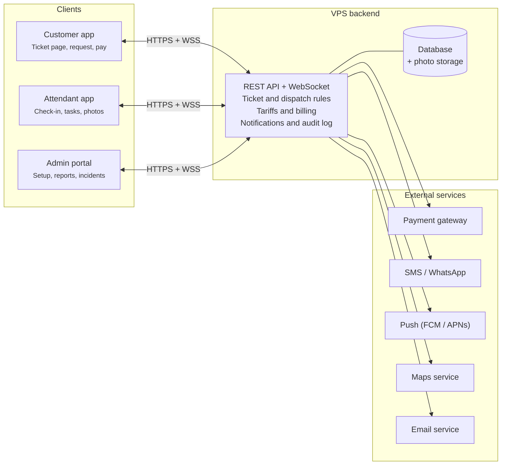
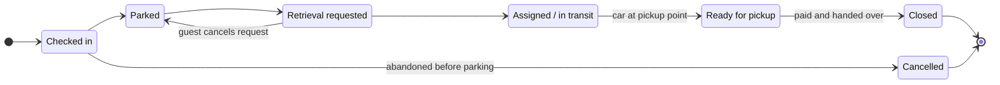

# Software Requirements Specification: Valet Parking System

Version 1.0 · Oct 17, 2026 · Manikanta

## Table of contents

1. [Introduction](#1-introduction)
2. [Overall description](#2-overall-description)
3. [Functional requirements](#3-functional-requirements)
4. [External interface requirements](#4-external-interface-requirements)
5. [Non-functional requirements](#5-non-functional-requirements)
6. [Data requirements](#6-data-requirements)
7. [Use cases](#7-use-cases)
8. [Open questions](#8-open-questions)

## 1. Introduction

The Valet Parking System (VPS) replaces paper valet tickets with a digital ticket that tracks every vehicle from drop-off to return, and lets guests request their car from their phone.

### 1.1 Purpose

This SRS defines the functional and non-functional requirements for VPS version 1.0. It is the agreed baseline for design, development, testing and acceptance, and follows the structure of IEEE 830 / ISO/IEC/IEEE 29148.

### 1.2 Scope

VPS consists of four components:

- **Customer web/mobile app** — receive a digital ticket, request the car, pay, rate the service.
- **Valet attendant app** — check vehicles in and out, record damage photos, park and retrieve.
- **Admin web portal** — manage locations, staff, pricing, reports and incidents.
- **Backend services** — API, database, notifications, payment integration.

In scope: hotels, restaurants, hospitals, malls and event venues running one or many valet locations. Out of scope for v1.0: automated (robotic) parking, licence-plate recognition cameras, and self-park garage gate control.

### 1.3 Definitions and acronyms

| Term | Meaning |
| --- | --- |
| Valet ticket | Unique digital record (with QR code and short number) for one vehicle visit |
| Attendant | Staff member who parks and retrieves vehicles |
| Supervisor | Staff member who runs a shift at a location |
| Location | A site offering valet service, with one or more parking zones |
| Zone / Slot | An area and a numbered space within a location where cars are parked |
| Key tag | Physical tag or hook number where the vehicle key is stored |
| ETA | Estimated time for the car to reach the pickup point |
| OTP | One-time password sent by SMS |
| PCI DSS | Payment Card Industry Data Security Standard |

### 1.4 References

- IEEE Std 830-1998, Recommended Practice for Software Requirements Specifications
- ISO/IEC/IEEE 29148:2018, Requirements engineering
- PCI DSS v4.0
- WCAG 2.1, Web Content Accessibility Guidelines

### 1.5 Document overview

Section 2 describes the product context and users. Section 3 lists functional requirements by module. Sections 4 and 5 cover interfaces and quality attributes. Section 6 defines the data model and ticket lifecycle. Section 7 gives key use cases, and section 8 lists open questions.

## 2. Overall description

VPS is a new, cloud-hosted, multi-tenant product: one deployment serves many operators, each with many locations, and every client talks to a single backend API.

### 2.1 Product perspective

The customer app, attendant app and admin portal are thin clients over a REST API. The backend owns all business rules and integrates with an SMS/WhatsApp gateway, a push-notification service, a payment gateway and a map service. The architecture diagram below shows the parts and what calls what.

The backend is the only component holding business rules and credentials for external services; clients never call those services directly.

### 2.2 Product functions (summary)

- Digital ticket issue at drop-off (QR code + SMS link)
- Vehicle check-in with photos, damage notes, key tag and parking slot
- Car retrieval request by the guest, with live status and ETA
- Task queue and assignment for attendants
- Payment (prepaid, pay-on-exit, validated/complimentary)
- Real-time occupancy dashboard per location
- Reports, audit trail and incident (damage) management

### 2.3 User classes

| User class | Main goals | Frequency | Technical skill |
| --- | --- | --- | --- |
| Customer (guest) | Get a ticket, request car, pay | 1–2 times per visit | Low; no app install required |
| Valet attendant | Check in, park, retrieve cars fast | Continuous during shift | Low–medium; uses phone with gloves, outdoors |
| Shift supervisor | Assign tasks, watch queue, handle issues | Continuous during shift | Medium |
| Location manager | Configure location, staff, pricing; view reports | Daily | Medium |
| Operator admin | Manage all locations and tenants' settings | Weekly | High |
| Merchant / validator | Validate or comp a guest's ticket (e.g. hotel front desk) | Occasional | Low |

### 2.4 Operating environment

- Customer app: responsive web (PWA) on current Chrome, Safari, Edge, Firefox; optional native Android 10+ / iOS 15+.
- Attendant app: Android 10+ and iOS 15+ phones; must work on rugged Android devices.
- Admin portal: desktop browsers at 1280×720 or larger.
- Backend: cloud hosting (e.g. AWS, Azure or GCP), containerised, relational database.

### 2.5 Design and implementation constraints

- Card data must never be stored by VPS; payments go through a PCI DSS compliant gateway (tokenised).
- Personal data handling must comply with applicable privacy law (e.g. India DPDP Act 2023, GDPR where guests are in the EU).
- The attendant app must keep working through short network loss (offline queue, sync on reconnect).
- All timestamps stored in UTC and shown in the location's time zone.

### 2.6 Assumptions and dependencies

- Each location has mobile data or Wi-Fi coverage at the drop-off and pickup points.
- Guests provide a mobile number to receive the ticket link.
- Third-party SMS, payment and push services are available at 99.9% or better.
- Physical key storage (key box/hooks) exists and is numbered.

## 3. Functional requirements

VPS has 60 functional requirements across nine modules; priorities use MoSCoW (Must, Should, Could), and every Must item is required for v1.0 acceptance.

### 3.1 Authentication and user management

| ID | Requirement | Priority |
| --- | --- | --- |
| FR-AUTH-01 | Staff shall log in with mobile number/email and password; customers shall access tickets via OTP or a signed ticket link without creating an account. | Must |
| FR-AUTH-02 | The system shall enforce role-based access control for the roles in section 2.3. | Must |
| FR-AUTH-03 | Admins shall create, edit, deactivate staff and assign them to one or more locations. | Must |
| FR-AUTH-04 | Staff sessions on the attendant app shall expire after 12 hours or at shift end. | Should |
| FR-AUTH-05 | Admin users shall be able to enable two-factor authentication. | Should |
| FR-AUTH-06 | Attendants shall clock in and clock out of a shift from the app. | Should |

### 3.2 Vehicle check-in (drop-off)

| ID | Requirement | Priority |
| --- | --- | --- |
| FR-IN-01 | The attendant shall create a ticket by entering the plate number, guest mobile number, vehicle make, model and colour. | Must |
| FR-IN-02 | The system shall generate a unique ticket number and QR code and send the guest a ticket link by SMS/WhatsApp within 10 seconds. | Must |
| FR-IN-03 | The attendant shall capture at least 4 vehicle photos (front, rear, left, right) with timestamp before parking. | Must |
| FR-IN-04 | The attendant shall mark existing damage on a vehicle diagram with notes. | Should |
| FR-IN-05 | The attendant shall record the key tag number and fuel level / odometer (optional fields). | Must |
| FR-IN-06 | The system shall support issuing a printed ticket via Bluetooth printer as a fallback. | Could |
| FR-IN-07 | The system shall recognise returning vehicles by plate number and pre-fill details. | Could |
| FR-IN-08 | The guest shall see and accept the terms and the recorded condition photos in the ticket page. | Should |

### 3.3 Parking and slot management

| ID | Requirement | Priority |
| --- | --- | --- |
| FR-PARK-01 | Admins shall define zones and numbered slots per location, with capacity. | Must |
| FR-PARK-02 | The attendant shall record the zone and slot where the vehicle is parked. | Must |
| FR-PARK-03 | The system shall suggest the nearest free slot based on current occupancy. | Should |
| FR-PARK-04 | The system shall prevent assigning a slot that is already occupied. | Must |
| FR-PARK-05 | Attendants shall move a vehicle to a new slot and the move shall be logged. | Must |
| FR-PARK-06 | The system shall alert the supervisor when a location reaches 90% occupancy. | Should |

### 3.4 Vehicle retrieval (pickup request)

| ID | Requirement | Priority |
| --- | --- | --- |
| FR-OUT-01 | The guest shall request the car from the ticket page with one tap. | Must |
| FR-OUT-02 | The guest shall be able to schedule a pickup for a future time (up to 24 hours ahead). | Should |
| FR-OUT-03 | Staff shall create a retrieval request on behalf of a guest by ticket number, plate or QR scan. | Must |
| FR-OUT-04 | The system shall show the guest live status (Requested, Assigned, On the way, Ready) and an ETA. | Must |
| FR-OUT-05 | The guest shall receive a notification when the car is ready at the pickup point. | Must |
| FR-OUT-06 | Before handover, the attendant shall verify the guest by scanning the ticket QR or entering the last 4 digits of the mobile number. | Must |
| FR-OUT-07 | The attendant shall capture return photos and close the ticket on handover. | Should |
| FR-OUT-08 | The guest shall be able to cancel a pending retrieval request. | Should |

### 3.5 Task dispatch and attendant workflow

| ID | Requirement | Priority |
| --- | --- | --- |
| FR-TASK-01 | The system shall place every retrieval request in a location queue ordered by request time (scheduled requests at their due time). | Must |
| FR-TASK-02 | Attendants shall accept a task from the queue; one task shall be held by only one attendant. | Must |
| FR-TASK-03 | Supervisors shall assign, re-assign and re-prioritise tasks (e.g. VIP). | Must |
| FR-TASK-04 | The system shall auto-assign tasks to the available attendant with the fewest active tasks when auto-dispatch is on. | Could |
| FR-TASK-05 | The system shall alert the supervisor when a task is not accepted within a configurable time (default 2 minutes). | Should |
| FR-TASK-06 | The attendant app shall show the slot, key tag, vehicle details and photos for each task. | Must |

### 3.6 Payment and billing

| ID | Requirement | Priority |
| --- | --- | --- |
| FR-PAY-01 | Admins shall configure tariffs per location: flat fee, hourly, daily cap, overnight, and free minutes. | Must |
| FR-PAY-02 | The system shall calculate the fee from check-in to retrieval request time using the location tariff. | Must |
| FR-PAY-03 | The guest shall pay online by card, UPI or wallet via the payment gateway before or at pickup. | Must |
| FR-PAY-04 | The attendant shall record cash or card-terminal payment at handover. | Must |
| FR-PAY-05 | Merchants shall validate a ticket for free or discounted parking. | Should |
| FR-PAY-06 | The guest shall be able to add a tip for the attendant. | Could |
| FR-PAY-07 | The system shall issue a digital receipt with tax breakdown by SMS/email. | Must |
| FR-PAY-08 | Managers shall issue full or partial refunds, with a reason, logged in the audit trail. | Should |
| FR-PAY-09 | The system shall support monthly pass holders who are not charged per visit. | Could |

### 3.7 Notifications

| ID | Requirement | Priority |
| --- | --- | --- |
| FR-NOT-01 | The system shall send the guest SMS/WhatsApp messages on ticket issue, car ready and payment receipt. | Must |
| FR-NOT-02 | The attendant app shall receive push notifications for new and assigned tasks. | Must |
| FR-NOT-03 | Admins shall edit message templates per location and language. | Should |
| FR-NOT-04 | The system shall retry failed messages up to 3 times and log the delivery status. | Should |

### 3.8 Incident and damage management

| ID | Requirement | Priority |
| --- | --- | --- |
| FR-INC-01 | Staff and guests shall report an incident (damage, lost item, delay) linked to a ticket, with photos. | Must |
| FR-INC-02 | Each incident shall have a status (Open, Under review, Resolved, Rejected) and an owner. | Must |
| FR-INC-03 | The incident view shall show check-in and return photos side by side for comparison. | Should |
| FR-INC-04 | Managers shall export an incident report as PDF for insurance claims. | Should |

### 3.9 Admin, dashboard and reporting

| ID | Requirement | Priority |
| --- | --- | --- |
| FR-ADM-01 | Admins shall create and configure locations: address, operating hours, zones, tariffs, pickup points. | Must |
| FR-ADM-02 | The dashboard shall show live per-location counts: cars parked, free slots, open requests, average wait time. | Must |
| FR-ADM-03 | The system shall provide daily, weekly and monthly reports: tickets, revenue, payment mix, average retrieval time, attendant performance. | Must |
| FR-ADM-04 | Reports shall be exportable to CSV and PDF. | Must |
| FR-ADM-05 | The system shall keep an audit log of all create, update, delete and payment actions with user and timestamp. | Must |
| FR-ADM-06 | Supervisors shall search tickets by number, plate, mobile number or date range. | Must |
| FR-ADM-07 | The system shall collect a 1–5 star rating and comment from the guest after handover. | Should |
| FR-ADM-08 | Managers shall view tickets older than a configurable limit (default 24 hours) as overdue vehicles. | Should |
| FR-ADM-09 | The system shall support multiple languages for the customer app (English plus at least one regional language). | Should |

## 4. External interface requirements

All clients use one versioned HTTPS REST API (JSON), plus a WebSocket channel for live status; external services are reached only from the backend.

### 4.1 User interfaces

- **Customer ticket page:** opens from the SMS link without login; shows ticket number, QR code, vehicle photo, status, ETA, fee and a large "Request my car" button.
- **Attendant app:** large touch targets (at least 48×48 dp), high-contrast theme for outdoor use, QR scanner, camera capture, task list with one-tap accept.
- **Admin portal:** dashboard, location setup, staff, tariffs, tickets, incidents, reports; tables with search, filter and export.
- All interfaces shall meet WCAG 2.1 level AA.

### 4.2 Hardware interfaces

| Device | Use | Requirement |
| --- | --- | --- |
| Smartphone camera | Vehicle photos, QR scan | Min. 8 MP, autofocus |
| Bluetooth thermal printer | Paper ticket fallback | ESC/POS compatible, 58 or 80 mm |
| Card payment terminal | Card payment at handover | Standalone; amount entered manually in v1.0 |
| Display screen at pickup | Queue / "car ready" board | Any browser-capable screen (optional) |

### 4.3 Software interfaces

| System | Purpose | Interface |
| --- | --- | --- |
| Payment gateway (e.g. Razorpay, Stripe) | Online payments, refunds | REST API + webhooks, tokenised cards |
| SMS / WhatsApp gateway (e.g. Twilio, MSG91) | Ticket links, OTP, alerts | REST API, delivery-status callbacks |
| Push service (FCM / APNs) | Attendant task alerts | Provider SDK |
| Maps service (e.g. Google Maps) | Location address, directions to pickup point | JavaScript / REST API |
| Email service (e.g. SES, SendGrid) | Receipts, reports | SMTP / REST API |
| Object storage (e.g. S3) | Vehicle and incident photos | Signed URLs |

### 4.4 Communication interfaces

- All traffic shall use TLS 1.2 or higher.
- The API shall use JSON over HTTPS, versioned in the path (e.g. /api/v1).
- Live status updates shall use WebSocket, with fallback to polling every 10 seconds.
- Webhooks from external services shall be verified by signature.

## 5. Non-functional requirements

The targets below are measurable acceptance criteria; the headline ones are 99.9% monthly uptime, API responses under 500 ms at the 95th percentile, and zero stored card data.

| ID | Category | Requirement |
| --- | --- | --- |
| NFR-PERF-01 | Performance | 95% of API requests shall complete in under 500 ms; 99% under 2 s. |
| NFR-PERF-02 | Performance | A retrieval request shall appear in the attendant queue within 3 s of the guest tapping "Request". |
| NFR-PERF-03 | Performance | The customer ticket page shall load in under 3 s on a 4G connection. |
| NFR-SCAL-01 | Scalability | The system shall support 500 locations, 5,000 concurrent staff users and 50,000 tickets per day without redesign. |
| NFR-SCAL-02 | Scalability | A single location shall handle peaks of 300 check-ins per hour. |
| NFR-AVL-01 | Availability | Monthly uptime shall be at least 99.9%, excluding announced maintenance (max 4 hours/month, off-peak). |
| NFR-AVL-02 | Availability | The attendant app shall queue check-ins and status changes offline for up to 30 minutes and sync automatically. |
| NFR-REC-01 | Recoverability | Database backups every 24 hours plus point-in-time recovery; RPO 15 minutes, RTO 4 hours. |
| NFR-SEC-01 | Security | Passwords shall be hashed with bcrypt or Argon2; data encrypted in transit (TLS 1.2+) and at rest (AES-256). |
| NFR-SEC-02 | Security | Ticket links shall use unguessable signed tokens and expire 24 hours after ticket closure. |
| NFR-SEC-03 | Security | Accounts shall lock for 15 minutes after 5 failed logins. |
| NFR-SEC-04 | Security | The system shall be tested against the OWASP Top 10 before each major release. |
| NFR-PRIV-01 | Privacy | Guest mobile numbers shall be masked to staff (last 4 digits) except supervisors and above. |
| NFR-PRIV-02 | Privacy | Vehicle photos and guest personal data shall be deleted or anonymised after a configurable retention period (default 90 days), except where linked to an open incident. |
| NFR-USE-01 | Usability | An attendant shall complete a check-in, including 4 photos, in under 60 seconds. |
| NFR-USE-02 | Usability | A new attendant shall be productive after 30 minutes of training. |
| NFR-MNT-01 | Maintainability | Backend code shall have at least 70% automated test coverage; deployments via CI/CD with rollback. |
| NFR-MNT-02 | Maintainability | The system shall provide centralised logs, metrics and alerting for errors and latency. |
| NFR-PORT-01 | Portability | Services shall run in containers and avoid lock-in to one cloud provider's proprietary services where practical. |
| NFR-LEG-01 | Compliance | Payment flows shall comply with PCI DSS (SAQ A scope); invoices shall meet local tax (e.g. GST) rules. |

## 6. Data requirements

The Ticket is the central record: every vehicle, photo, task, payment and incident hangs off one ticket, and its status moves through a fixed lifecycle.

### 6.1 Core entities

| Entity | Key attributes | Relationships |
| --- | --- | --- |
| Operator (tenant) | id, name, tax id, settings | has many Locations, Users |
| Location | id, name, address, time zone, hours, capacity | has many Zones, Tariffs, Pickup points, Tickets |
| Zone / Slot | id, code, slot number, status (free/occupied/blocked) | belongs to Location; holds 0–1 Vehicle |
| User | id, name, mobile, email, role, status | assigned to Locations; performs Tasks |
| Customer | id, mobile, name (optional), language | has many Tickets, Vehicles |
| Vehicle | id, plate number, make, model, colour | has many Tickets |
| Ticket | id, ticket number, QR token, status, check-in time, request time, close time, key tag, slot | links Customer, Vehicle, Location; has Photos, Tasks, Payments, Incidents |
| Photo | id, type (check-in/return/incident), URL, timestamp, taken by | belongs to Ticket or Incident |
| Task | id, type (park/retrieve/move), status, assigned to, timestamps | belongs to Ticket |
| Tariff | id, type, rates, free minutes, daily cap, valid from/to | belongs to Location |
| Payment | id, amount, tax, tip, method, gateway ref, status | belongs to Ticket |
| Validation | id, merchant, discount type/value | applied to Ticket |
| Incident | id, type, description, status, owner | belongs to Ticket |
| Audit log | id, user, action, entity, before/after, timestamp | references any entity |

### 6.2 Ticket lifecycle

A ticket moves through these states in order; Cancelled is reachable only before Parked.

1. **Checked in** — ticket created at drop-off; photos and details captured.
2. **Parked** — vehicle placed in a slot; slot marked occupied.
3. **Retrieval requested** — guest or staff requests the car (or a scheduled time arrives).
4. **Assigned / In transit** — an attendant accepted the task and is bringing the car.
5. **Ready for pickup** — car at the pickup point; guest notified.
6. **Closed** — payment settled and car handed over; slot freed.

A retrieval request cancelled by the guest returns the ticket from Retrieval requested to Parked.

### 6.3 Data retention

- Tickets, payments and audit logs: retained 8 years for tax/accounting (configurable per jurisdiction).
- Photos and guest contact data: per NFR-PRIV-02.

## 7. Use cases

Four use cases cover the core guest journey; each lists actor, preconditions, main flow and the main exceptions.

### UC-01 Drop off vehicle

- **Actor:** Valet attendant (primary), Customer
- **Precondition:** Attendant logged in and clocked in at the location.
- **Main flow:**
  1. Guest arrives at the drop-off point and hands over the key.
  2. Attendant enters plate number and guest mobile number (FR-IN-01).
  3. Attendant captures 4 photos and notes damage (FR-IN-03, FR-IN-04).
  4. Attendant records key tag; system issues ticket and sends the link (FR-IN-02).
  5. Attendant parks the car and records zone and slot (FR-PARK-02).
- **Exceptions:** No network → ticket saved offline and printed (NFR-AVL-02, FR-IN-06). Guest declines to give a number → printed ticket only.
- **Postcondition:** Ticket in state Parked; slot occupied.

### UC-02 Request vehicle

- **Actor:** Customer
- **Precondition:** Ticket in state Parked.
- **Main flow:**
  1. Guest opens the ticket link and taps "Request my car" (FR-OUT-01).
  2. System shows the fee and offers online payment (FR-PAY-02, FR-PAY-03).
  3. System adds the task to the queue and notifies attendants (FR-TASK-01, FR-NOT-02).
  4. Guest sees live status and ETA (FR-OUT-04).
- **Exceptions:** Payment fails → guest can pay at handover. Guest cancels → ticket returns to Parked (FR-OUT-08).

### UC-03 Retrieve and hand over vehicle

- **Actor:** Valet attendant
- **Precondition:** Retrieval task in queue.
- **Main flow:**
  1. Attendant accepts the task and sees slot, key tag and photos (FR-TASK-02, FR-TASK-06).
  2. Attendant drives the car to the pickup point and marks it Ready; guest notified (FR-OUT-05).
  3. Attendant verifies the guest by QR scan or mobile digits (FR-OUT-06).
  4. Attendant collects payment if unpaid, captures return photos and closes the ticket (FR-PAY-04, FR-OUT-07).
- **Exceptions:** Task not accepted in 2 minutes → supervisor alerted (FR-TASK-05). Verification fails → supervisor override required.
- **Postcondition:** Ticket Closed; slot free; receipt sent (FR-PAY-07).

### UC-04 Report damage

- **Actor:** Customer or staff; Location manager
- **Main flow:**
  1. Reporter opens the ticket and submits an incident with photos (FR-INC-01).
  2. Manager compares check-in and return photos (FR-INC-03).
  3. Manager sets the outcome and exports the report if needed (FR-INC-02, FR-INC-04).

## 8. Open questions

- [ ] Which payment gateway and SMS provider will be used in the first market?
- [ ] Is a native app required for customers in v1.0, or is the web ticket page enough?
- [ ] Should licence-plate recognition be planned for v2.0?
- [ ] What is the legally required retention period for vehicle photos in the target jurisdictions?
- [ ] Is integration with hotel property-management systems (room charge) required?
